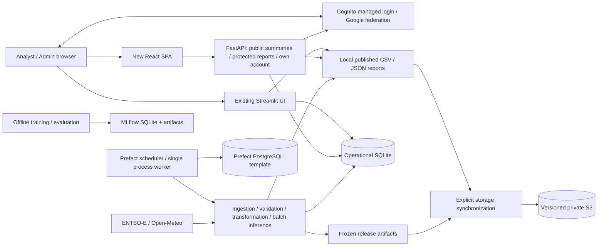

# Phase 5A — production architecture and infrastructure audit

22 October 2026, Africa/Nairobi. Branch `feature/react-frontend`; baseline `fcb89eb`. **Audit and roadmap only. Phase 5B is not started.** No AWS, Cognito, deployment, account, database or production-data changes; no restarts, staging, commits, pushes, merges or Git history changes.

## Decision summary

Recommend a **small modular deployment on the existing EC2 host**, conditionally on measured memory/CPU headroom and the security/readiness gates below: Nginx serves versioned React static files and proxies same-origin `/api/` to a loopback-only FastAPI process. Keep the existing Streamlit hostname/application intact during staging and use a separately approved React hostname initially. Keep a single scheduled pipeline writer and persistent local datasets; APIs consume published outputs, never run pipelines or models on HTTP requests. Validate first on an isolated staging host with no production write credentials or active ingestion schedule.

This is a cost-conscious single-host design, **not high availability**. Separate static hosting is a reasonable later improvement; it does not make the data/API tier redundant. Do not add Kubernetes, Redis, a message broker, RDS or a second orchestrator without a measured need. Do not treat passing tests or source-controlled service files as proof that these components are currently deployed.

Production release is currently **no-go**: installed host/proxy evidence and TLS validation remain incomplete, root operational access is in use, persistent storage/recovery controls need confirmation/remediation, the API service template omits required authentication environment, dependency reproducibility is inconsistent, and abuse/readiness/release controls need engineering. Lost-authenticator recovery remains unverified; regular-user MFA enrollment must remain off.

## Evidence method and limitations

- **Repository-confirmed:** source, service templates, manifests, schema, tests and local build inspected. Local paths/sizes/configuration below are not production measurements.
- **AWS-confirmed:** read-only CLI inventory in us-east-1 after the owner refreshed an expired default login. Instance identifiers, addresses, bucket identifiers and account numbers are intentionally omitted; sanitized local evidence is in `/tmp/pf5a-aws-sanitized.json` and follow-up summaries. Missing/failed calls are not interpreted as resource absence.
- **Historical owner acceptance:** Phase 4E.3 documented production native TOTP login, Analyst display, two read-only pages and application sign-out. No new sign-in or production navigation was performed here. Recovery, global revocation and all-user enrollment were not established by that test.
- **Not established:** running host processes, installed Nginx config, certificate files/renewal, OS patch level, disk free space/RAM, actual Prefect schedule execution, backup timer or restore time. Basic CloudWatch CPU/credit evidence was subsequently collected; host memory/disk metrics remain unavailable. No SSH, remote shell, SSM command, configuration dump, secret retrieval or active security scan was executed.
- Public DNS resolves, but Python (including certifi) and system curl failed certificate-chain verification from this audit environment. No verification bypass was used. The cause may be the served chain or local/network trust; it is **not established as a production certificate defect**. Public response headers and current `/api/health` could not be verified. Browser success in the prior acceptance is distinct historical evidence. Independently validate chain/expiry/renewal and security headers before cutover.
- AWS inventory is regional, not an organization-wide discovery. Empty regional ACM lists do not rule out edge certificates in another region; no Route 53 hosted zones in this account does not rule out external DNS. No configured CloudTrail trail does not mean AWS event history is absent.

## 1. Repository and component inventory

| Component | Source / configuration | Actual responsibility and deployment caveat |
|---|---|---|
| React SPA | `frontend/src`, `App.tsx`, `main.tsx`, `vite.config.ts`, `package.json` | React/TypeScript, Router, Tailwind v4 Vite plugin, Lucide, Recharts. Seven protected pages plus OIDC callback/404. Build emits static dist; Vite proxy is development-only. |
| Browser identity | `frontend/src/auth/*` | Cognito code + S256 PKCE, nonce/state, sessionStorage, explicit reauthentication for self-service scopes, sanitized errors, expiry/logout handling. No browser client secret. |
| HTTP API | `src/api/app.py`, `market_data.py`, `anomalies.py`, `feature_parity.py`, model/operational summary modules | Persisted market/report reads; no ingestion/training on requests. Source also includes token-authorized own-account writes to Cognito, so the whole API must not be described as exclusively read-only. |
| API security | `security.py`, `account_service.py`, `account_routes.py`, `mfa_routes.py`, `mfa_service.py` | Trusted Cognito JWT checks, group-based Admin, current-user provider validation, constrained own-account changes. No administrative recovery endpoint/IAM browser credential. |
| Streamlit | `src/dashboard.py`, `dashboard_data.py`, `dashboard_health.py`, `auth.py` | File/SQLite-backed analytics with independent OIDC client. Reads persisted outputs directly, not through React/FastAPI. Preserve throughout migration. |
| Orchestration | `src/scheduled_pipeline.py`, `prefect.yaml`, `scripts/setup_prefect_ec2.sh`, `deploy/systemd/*prefect*` | Hourly UTC incremental process deployment, configured concurrency=1 and worker limit=1. Persistent checkout, no clone pull. Template Prefect server uses local PostgreSQL; this is distinct from PowerFlow operational SQLite. Deployment registration/activity not freshly verified. |
| Ingestion | `src/ingestion/*` | ENTSO-E prices/load/generation, historical/incremental merges, operational forecast vintages; Open-Meteo archive/forecast weather. ENTSO-E key required; external outages, quotas, revisions and publication lag affect freshness. Legacy EIA code remains under `src/legacy` and is not the active ENTSO-E production path. |
| Validation/transformation | `validate_data.py`, `processing/build_silver_dataset.py`, `build_gold_dataset.py`, exogenous Silver builder | Hourly UTC integrity/required fields, Silver observations, Gold feature layer. Source completeness, not merely file existence, gates forecasts. |
| Frozen inference | `models/final_model_runtime.py`, `next24h_production.py`, `prediction_visualization.py`, release manifests | Separate one-hour Linear Regression and production 24-output Histogram Gradient Boosting. Preserve feature order, weights, release digests and withholding logic. |
| Anomaly execution | `models/anomaly_detection.py` | Batch IsolationForest on persisted Silver price/load, contamination=0.01, random_state=42; saves anomalous rows/plot. Not a real-time detector, fraud verdict or model forecast error. Executes at script/module top level; never import casually into API worker. |
| Research/MLflow | `models/train_gold_model.py`, evaluation/tuning/backtest scripts | MLflow training URI defaults to `sqlite:///mlflow.db`; artifacts in local MLflow storage. Research imports excluded by production import checker. No evidence a public/running MLflow service is required for frozen inference. |
| Storage adapters | `src/storage/*` | Local paths remain runtime input; optional S3 synchronization by explicit object groups, content hash and verified temporary upload/copy. S3 is not transparently the API filesystem. |
| Recovery | `operational_recovery.py`, `scripts/*operational*`, `docs/production_recovery_runbook.md` | Consistent SQLite backup API, manifests/hashes/schema checks, safe explicit restore destinations, optional S3 operational backups. Tool existence is not evidence of a scheduled successful backup or tested disaster recovery. |
| Deployment | `deploy/powerflow-api.service`, Nginx location snippet, three systemd templates, Docker/Compose | Source-controlled examples; do not assert installed state without host evidence. No React production host config/release automation exists in these templates. |
| Secrets | `.env.example`, `powerflow_secrets.py`, ignored Streamlit secrets | env/SSM/Secrets Manager abstractions. AWS secret mode insists on instance-role credentials and rejects static credential environment fallback. Runtime mode/configuration is not inferred from example defaults. No secret values read. |
| Tests/CI | 45 Python test files, frontend Node tests, `.github/workflows/ci.yml` | Broad isolated auth/data/model/recovery coverage. Existing CI runs Python 3.14 tests/import checks/artifact digests; no frontend test/lint/build job found. Local tests are not installed-host acceptance. |

### Component diagram — repository architecture, deployment status qualified



The diagram describes code relationships, not a claim that every box is currently running in AWS.

### Request and data flow — proposed target

```mermaid
sequenceDiagram
  participant B as Browser
  participant N as Nginx HTTPS
  participant C as Cognito
  participant A as FastAPI loopback
  participant P as Single pipeline writer
  participant D as Published snapshots / SQLite
  B->>N: GET React route / static assets
  N-->>B: Versioned SPA (history fallback)
  B->>C: Code + PKCE authentication
  C-->>B: Validated application callback
  B->>N: /api request (bearer on protected calls)
  N->>A: Strip /api prefix; trusted proxy headers
  A->>C: Trusted JWKS / live account validation as required
  A->>D: Read bounded persisted data
  D-->>A: Snapshot/version + observations
  A-->>B: Allowlisted response / explicit unavailable state
  P->>D: Validate and publish new immutable output version
  Note over P,A: No inference, training or pipeline trigger through analytics HTTP
```

## 2. Verified AWS infrastructure

Audit scope: us-east-1 and applicable account-global list APIs, 22 October 2026. Successful refreshed inventory captured at 09:12 UTC; supplemental reads below refine unknowns.

| Area | Verified result | Implication / limit |
|---|---|---|
| Operator | Root identity; expected account fingerprint | High operational privilege risk. No IAM identity created or changed. |
| EC2 | One running t3.small, us-east-1f; public IPv4; EBS root; attached instance profile | 2-vCPU/2-GiB class requires measured headroom; sole host/AZ remains failure domain. Instance type does not prove usable RAM/free disk. |
| Metadata | IMDSv2 required, endpoint enabled, hop limit 2 | Positive protection; review container metadata reach and isolate workload privileges. |
| Security group | Attached group permits TCP80/443 from all IPv4, SSH22 from one /32; no public IPv6 ingress shown | No SG ingress for 8000/8501/4200/5000/5432. This is rule evidence, not a port scan or proof of host bindings/proxy configuration. |
| EBS | One in-use 20-GiB gp3 volume, **unencrypted**; attached mapping DeleteOnTermination=true | Persistent state can be lost on termination. Encryption remediation needs an approved copy/replacement migration; do not assume an in-place toggle. |
| Network | One VPC, one allocated EIP, no NAT gateways listed; no ELBv2 load balancers | No managed frontend load balancer confirmed. EIP allocation alone does not prove domain routing or assignment. Route/NACL configuration not inspected. |
| DNS/TLS | No Route 53 hosted zones in account; no regional ACM certificates listed | Registrar/authoritative DNS and host TLS renewal still need evidence; do not infer domain absence or plaintext production. |
| Monitoring | Detailed EC2 monitoring disabled; no CloudWatch log groups or metric alarms listed | Basic EC2 metrics can still exist. No remote application log/alert delivery demonstrated. |
| Recovery | No owned EBS snapshots or AWS Backup plans listed in region | Local/S3/custom backup tools may exist, but no volume recovery point is demonstrated by these APIs. |
| Audit/access | No configured CloudTrail trails or SSM-managed instances returned | AWS event history may still exist. Do not assume SSM remote inspection available or enable it without approval. |
| S3 | One PowerFlow-named bucket discovered: all four public-access-block flags true; versioning enabled; default AES256/SSE-S3 encryption | Positive data protection controls. Public blocking is not a complete IAM/bucket-policy review. Current versions and noncurrent versions affect bill/retention. |
| Cognito | OPTIONAL software-token MFA enabled; recovery email then phone; verification-before-email-update list empty | Keep general enrollment disabled and email editing unavailable. Prior production test is narrow acceptance, not recovery proof. |

An initial expired login and timeout yielded unusable empty results; those are explicitly excluded. In the refreshed inventory, bucket lifecycle and inline-role enumeration had errors and were retried separately; no empty-policy/no-lifecycle conclusion is based on those failures.

### Installed-host evidence still required

Obtain a sanitized operator-supplied read-only inventory of service names/active state, process listening addresses, installed Nginx routing, TLS chain/expiry/renewal timer, deployed commit/interpreter/packages, mount ownership/free bytes, CPU/RAM/credits, backup schedule/latest manifest, Prefect deployment last runs, PostgreSQL version/backup, and log rotation. Do not print process environments, secrets.toml, `.env`, authorization headers, full logs, private keys or account tokens. Do not run restarts, `nginx -s reload`, deployment registration, SSM commands or pipeline runs as an audit shortcut. These gaps can be addressed through separately reviewed read-only host access without authorizing writes.

## 3. Persistence and data/ML reliability

### Distinct state stores

| Store | Location / role | Persistence and recovery requirements |
|---|---|---|
| Operational SQLite | `database/electricity_trading.db` | pipeline_runs, data_quality_results, operational_incidents, pipeline_stage_timings in primary schema. Retain consistent backup + manifest; don't raw-copy a busy DB. |
| Market layers | data/raw, data/processed Silver, data/features Gold | Primary analytics history is CSV, **not a large market table in SQLite**. Preserve timestamp/column contracts and source provenance. S3 object mappings support recovery, not API direct S3 reads. |
| Forecast/report layers | data/reports and monitoring | Retained valid forecast can coexist with newer WITHHELD status. Back up as a coherent release/run set, not arbitrary independent latest files. |
| Frozen models | artifacts/models, separate next24h release directory | Immutable hashes/manifests, features, runtime version; trusted joblib artifacts only (deserialization is executable-code risk). Never load caller-supplied artifacts. |
| MLflow | mlflow.db + MLflow artifact directories | Research/training tracking, distinct from operational SQLite and Prefect metadata. Back up both metadata and referenced artifacts if retained; no requirement to run MLflow UI publicly. |
| Prefect metadata | Template local PostgreSQL; possible other local dev defaults | Schedules/work pools/history are separate from observation data; snapshot DB plus deployment definitions; avoid silently creating another server/metadata DB. Actual installed backend unverified. |

Local-only observations: operational DB ~116 KiB and journal_mode=delete, Silver ~10.9 MiB, Gold ~19.6 MiB, one-hour report ~754 KiB; data tree ~103 MiB, artifacts ~42 MiB, mlruns ~2.8 GiB. Local DB retains legacy tables and lacks the two new operational tables despite the source schema; this is real local schema drift, not proof production is missing them. The local next24h report is absent while both release manifests exist. These are honest missing-data states, not justification to run ingestion, initialize production schema or fabricate reports.

### Reliability strengths and gaps

- Pipeline defines hourly UTC schedule, two-retry external fetch tasks, source repair/revision accounting, stage timing, deduplicated incidents, alert cooldown and S3 sync status. A process worker limit of one supports serialized writes. Manual invocations can bypass deployment concurrency; add an approved global writer lock before parallel environments share data.
- ENTSO-E actual series/forecast vintages and Open-Meteo observations/forecast vintages are distinct. Optional vintage collection is non-blocking; its failure can coexist with other successful stages. Never label all downstream products healthy from overall SUCCESS alone.
- One-hour model verifies frozen features and produces historical actual-vs-predicted output. Next24h validates manifest hashes, 31-feature order, 24 horizons, recent/complete history and retained-output contracts. It withholds rather than fabricates when requirements fail. Default issuance max age is three hours; do not relax it for deployment/demo.
- IsolationForest currently refits a batch detector on full Silver; it is not a request-path inference endpoint. Model/score/generation-time metadata are limited. Treat outputs as statistical outliers and monitor report age separately.
- Next24h CSV publication uses temporary-file replacement, but Silver and Gold builders call direct `to_csv`. API mtime/size checks can detect many concurrent changes and fail 503, but do not provide transactionally coherent multi-file versions. Require atomic publication/manifest strategy in a later reviewed phase without changing feature calculations or withholding rules.
- MarketStore builds an in-memory SQLite snapshot per Silver file version, under a process lock, streams CSV (512-MiB / 2M-row caps), detects source change and does not silently reuse a stale snapshot after validation error. It amortizes reads but serializes work; per-worker memory duplication and cold rebuilds require measurement. S3 sync is per object, not a multi-object transaction.
- Operational writes use SQLite connections with defaults; no explicit WAL/busy-timeout strategy was found in the writer. The **local** DB uses delete journaling. Read-only API connections can still contend with writes; test simultaneous ingestion/status reads and establish bounded lock failure handling before changing pragmas. WAL is not a universal distributed/network-filesystem solution.
- Foreground chart queries are bounded, but exploration aggregates scan ranges and issue per-point gap checks. One-hour API reads/returns the complete report even though charts display only the last 500 points; payload/history growth creates a memory/bandwidth and unauthenticated abuse risk. Add a backward-compatible bounded endpoint/pagination contract, not silent truncation.
- Logs use a plain pipeline FileHandler plus console. Rotation/disk caps and redaction must be checked for all exception paths, not only account/incident schemas. No deployment configuration proves alert delivery or unattended recovery.

### SQLite versus PostgreSQL decision

Keep operational SQLite initially for one writer on local persistent disk with short bounded reads, tested backup and lock handling. Migrating this small metadata DB will **not** remove CSV rebuilds or deliver API autoscaling. Existing Prefect PostgreSQL is not permission to mix application data into it. Adopt separate application PostgreSQL only after measured write contention, multi-host writers, required multi-instance API consistency or relational query volume justify migration, dual-read validation, backups and rollback. No schema/database migration is authorized in this phase.

Proposed recovery objectives for approval, not existing guarantees: operational metadata RPO ≤24h initially, published observations/reports RPO ≤1 scheduled publication interval where validated versioned backups exist, RTO ≤2h from a clean host. Measure restore time and achievable source replay before accepting these targets. Include Prefect DB, immutable models, publication manifest and secured configuration recreation; S3 sync/versioning alone is not a full disaster-recovery plan.

### Supplemental verified infrastructure evidence

Read-only follow-up confirmed: EC2 instance/system checks both OK; x86_64 Amazon Linux 2023 image metadata; t3 CPU credits set to **unlimited** (possible surplus-credit costs). The public DNS A resolution matched the running instance's current public IPv4. Public NS lookup returned Name.com nameservers; no CNAME or CAA records returned at the apex. This identifies authoritative DNS hosting, not registrar ownership or certificate authority. Host software/patch level is not established by AMI description.

Instance role inline policy read succeeded on retry: scoped S3 ListBucket/GetBucketLocation, object Get/GetVersion/Put/**DeleteObject/DeleteObjectVersion**, and SSM GetParameter on a parameter resource. No attached managed policies were listed. No blanket `Resource:*` found in these statements, but common-host roles still cover more than an API needs. Do not infer effective permissions from these statements alone: resource policies, trust, boundaries/SCPs and precise prefix conditions were not exhaustively evaluated. Separate pipeline/backup/API responsibilities before increasing public exposure; deletable S3 versions weaken recovery isolation.

S3 lifecycle read returned **NoSuchLifecycleConfiguration**, confirming no lifecycle rules. Backup-prefix metadata listing returned **two objects**, no truncation, newest LastModified **12 October 2026 14:07:58 UTC**. No object contents were downloaded; completeness/hash/integrity and a restore were not validated. This does not demonstrate a current daily backup or accepted RPO. Model-prefix sample returned five objects with further results; presence is not version/hash proof. Bucket-policy-status call did not succeed; no public/private policy conclusion was drawn from that failure. Public-access blocking/encryption/versioning remain positively verified controls.

Final read-only confirmation matched the role's DeleteObjectVersion resource pattern against the operational-backup prefix: an inline Allow covers that prefix. This is policy exposure evidence, not an attempted deletion or a complete effective-policy simulation.

Basic CloudWatch metrics over the prior 24 hours returned 24 hourly buckets: mean of hourly CPU means **3.33%**, minimum sample **2.11%**, maximum sample **45.47%**; CPUCreditBalance min/max **576**; CPUSurplusCreditsCharged sum **0**. This supports low recent average CPU demand, not memory/disk headroom, future traffic capacity or a guarantee of zero monthly burst charges. No CPU resize is justified by this sample alone. Evidence: `/tmp/pf5a-metrics-summary.json`.

Public headers/chain still could not be inspected with normal TLS verification. Do not infer a particular Nginx version, Let's Encrypt installation, HSTS, CSP or expiry date from repository documentation or prior screenshots.

## 4. FastAPI production-readiness review

| Concern | Current implementation | Required production work |
|---|---|---|
| ASGI/process | Template Uvicorn 127.0.0.1:8000, one worker, trusted forwarded IP only loopback, on-failure restart/30s stop timeout | Verify installed state. Keep one worker while MFA metadata is process-local; don't blindly increase worker count. Measure memory, concurrency, threadpool saturation and graceful stop. |
| Security environment | Code fails protected routes closed when issuer/client config absent. API unit does **not** supply these settings or load `.env` | Add a reviewed non-secret API-specific config/service drop-in; verify exact SPA issuer/client scopes/audience. Never load ingestion credentials into HTTP service merely to obtain public identity settings. |
| Public/protected contract | Public health/pipeline summary/forecast/market/anomaly/model/evaluation routes; authenticated `/auth/me` and own account; five `/admin/*` routes plus two legacy monitoring aliases Admin-only | Record explicit data-owner acceptance of public market/forecast contract. React route protection alone does not protect public API data. Preserve the seven restricted denials; don't reopen aliases or add diagnostic bodies. |
| JWT / revocation | Signature, issuer/client/access-type/expiry/scope checks; bounded JWKS cache; live provider account validation; exact trusted group Admin | Keep fail-closed behavior, test JWKS/provider outage/revocation and client changes. No production IAM keys needed by account APIs. Network availability is now part of authenticated request latency. |
| Reverse proxy / TLS | Source snippet strips `/api/`, forwards trusted headers; no public API port intended | Verify actual TLS chain and config; history fallback must exclude `/api` and callback/static collisions. Decide disable public OpenAPI docs or configure public root_path/URLs correctly. Do not assume snippet installation. |
| CORS | No permissive CORS middleware found; Vite proxy supports local requests | Prefer browser same-origin `/api` in production too. Separate static hosting needs same-origin CDN proxy or narrowly allowed exact HTTPS origins, not wildcard credentials. CORS is not authorization. |
| Validation | Pydantic schemas, bounded pages/dates/allowlists; own-account body limit 16KiB and strict fields | Enforce global proxy body/header limits/timeouts; retain safe 401/403/422/429/503 responses; cap unbounded legacy history/report reads compatibly. |
| Abuse | Setup store/attempt bounds, JWKS refresh backoff, provider limits | No app-wide/proxy rate limiter in inspected code. Define per-route rate/concurrency limits with safe 429s, especially public CSV-heavy endpoints and account operations; test shared-IP users. Single-process ticket limits aren't global request protection. |
| Liveness/readiness | `/health` always reports process OK; data/identity config can still fail | Keep liveness separate; add readiness/config/mount/schema checks and sanitized data-product freshness evidence. WITHHELD must remain an honest product state, not a reason to fabricate or a global restart loop. |
| Data access | Read-only SQLite URIs; SQL-bound filters; versioned in-memory Silver index; output schemas | Profile cold/warm latency and concurrent source publication. No caller-controlled filesystem paths/SQL identifiers. No inference/training on request threads. |
| Runtime isolation | Unit has NoNewPrivileges, PrivateTmp, UMask, ProtectSystem/Home protections but uses ec2-user | Dedicated unprivileged API user with read-only published-data access, restricted service config and no shared ingestion secrets; validate before applying. EC2 role access/metadata reach is a host isolation concern. |
| Shutdown | Lifespan closes market snapshot; Uvicorn template timeout/restart | Test active request cancellation, half-finished reads, setup expiry and restart behavior in staging. No success response after uncertain provider mutation. |
| Logging | Account errors sanitized, no tokens intentionally logged; general exceptions/access logs and pipeline FileHandler remain | Redacted structured logs/request IDs, bounded rotation/retention, no callback query strings/Authorization/TOTP/password/secret data in proxy access/error logs or remote reporting. Need redaction tests. |

The inherited description “read-only service” is incomplete now: account profile/password/global sign-out/enrollment routes can change the authenticated user's Cognito state. Analytics remain read-only and no administrative reset endpoint exists. Production deployment review must acknowledge both surfaces.

## 5. React readiness — all seven pages reviewed in source

| Route/page | Existing source-backed behavior | Deployment/readiness concerns |
|---|---|---|
| `/` Executive Overview | Public market/anomaly/operations/pipeline/forecast summaries and sampled history chart | Multiple simultaneous + 60s polling calls; measure cold snapshot rebuild. Pipeline SUCCESS must not override stale/withheld forecast classification. |
| `/analytics` Market Intelligence | Date filters, real price/load/generation/renewable/weather charts, comparison outputs | URL/query limits and clear missing-data bounds; chart responsiveness/keyboard verification still needs staging browsers. |
| `/forecasting` Forecast Intelligence | 24-hour persisted forecast, conservative status classification, historical one-hour data/evaluation, Admin provenance | Full one-hour report download every refresh grows unbounded; keep historical labeling and model-specific metrics; test missing/retained/WITHHELD data. |
| `/anomalies` Anomaly Detection | Persisted IsolationForest events, filters, charts and pagination | Do not claim live detection or anomaly scores/timestamps not stored. Keep returned row limits and absent-data handling. |
| `/models` Model Insights | Actual distinct model releases/evaluations; coefficient report Admin-only | Preserve metric/feature provenance and server-verified role gating; don't expose joblib/artifact filesystem. |
| `/pipeline` Pipeline Operations | Safe source freshness/check summaries; detailed bounded Admin history/vintages/readiness | Historical monitoring != present health. Seven Admin-only endpoints must retain server enforcement. |
| `/profile` My Profile | Verified own account attributes, native/Google differences, supported edits/password/sign-out; MFA gated | General enrollment off, email editor absent, recovery guidance honest. Never put real passwords/tokens/codes in test artifacts or error reporting. |

Shared readiness:

- Build uses Vite + TypeScript and locally served Source Sans 3; design remains white/grey/bright-blue, with semantic chart colors. No redesign is needed.
- All API calls are same-origin `/api`; dev Vite rewrites to loopback8000. Production static hosting does not inherit that proxy. Production must explicitly route it, including safe 401/403/error bodies and no SPA HTML fallback on API failures.
- Example OIDC callback/logout uses localhost:5175; these are public build-time settings, **not production-ready callbacks**. `readAuthConfig` supports exact HTTPS callback `/auth/callback` and logout `/`; all VITE settings become public bundle contents. Separate approved staging/production clients/URLs prevent disruption to Streamlit. Never embed a client secret.
- BrowserRouter requires direct deep-link/history fallback for seven routes and callback. Real asset 404s must not return index.html; API failures must not be hidden. Long-cache content-hashed assets, no-cache index/config; retain preceding assets during rollout.
- sessionStorage, code+PKCE and nonce/state handling are established; JS-readable tokens remain exposed to successful XSS. Apply least-privilege CSP and dependency discipline. A BFF/HTTP-only-cookie architecture is an optional separately scoped change, not a quick token-storage toggle.
- No root React error boundary was found. Add a safe recoverable failure UI for render/lazy-chunk failures. Existing panels handle API loading/empty/error/retry; do not assume this catches render crashes.
- Build emitted main JS **458.33 kB / 135.73 kB gzip**, large chart chunk **338.50 kB / 99.21 kB gzip**; chart modules use lazy loading in several places, but route modules are eagerly imported. These are emitted sizes, not measured initial network payload or performance scores. Establish a real browser budget and avoid duplicate request/report transfers before introducing another cache layer.
- No explicit CSP/HSTS/header deployment policy found; public headers unavailable in this audit. Introduce CSP in staging/report-only first: self scripts, explicit Cognito connections, self font, constrained frames/objects/base URI and compatible Recharts inline styles. Don't promise `style-src 'self'` alone works. Test hosted redirects/callbacks, no token telemetry and frame-ancestor protection.
- No explicit Vite sourcemap option found; default production maps were not observed in emitted build. Decide privately retained maps and redacted error reporting, never publish raw account events/claims. Inspect output for secret strings before deployment without printing matches.
- Responsive sidebar/forms and semantic labels are present; prior tests cover several interactions. This audit is source/build review, **not** a fresh visual/a11y pass across devices. Require desktop/tablet/mobile, keyboard, focus and screen-reader checks on staging.
- useApi cancels on effect cleanup and clears data on errors; timer refreshes can overlap if a request outlasts the interval, allowing older completion to replace newer. Current analytics timeout is15s vs60s polling, reducing but not proving absence across all uses. Add controlled concurrency/order tests rather than assert a demonstrated exploit.

## 6. Security and reliability priorities

Severity reflects production impact if the condition is present; confirmed source/configuration is distinguished from unverified exploitation. No destructive or active penetration tests were run.

| Priority | Finding / evidence | Practical remediation and gate |
|---|---|---|
| High | Root CLI operator confirmed | Approved short-lived least-privilege operator role, MFA/identity accountability and reviewed deploy/recovery permissions; do not routinely use root for deployments. |
| High | EBS unencrypted, termination deletion; no owned snapshots/Backup plans; old backup-prefix metadata | Approve encrypted-volume replacement plan, consistent scheduled off-host backups, retention and restore drill. Do not claim versioned S3 is an undeletable backup. |
| High | Pipeline role permits DeleteObjectVersion; common host APIs could reach instance credentials | Separate workload privileges/data ownership and restrict backup deletion. Review actual resource conditions, metadata access and host users; preserve necessary temporary-upload cleanup. |
| High | Docker `COPY . .`, .dockerignore omits `.streamlit/secrets.toml`, general backups, `.env.*`, frontend node_modules and other sensitive local files | Before any image build/push, explicit allowlisted context/multistage build, secrets exclusion, read-only data mounts, non-root user and image scanning. Potential build-time exposure, **not evidence a secret-bearing image was deployed**. |
| High | Unit lacks required API identity config; no installed-host readiness proof | Non-secret service-specific config, missing-config tests and staged 401/403/provider verification before exposure. Existing fail-closed behavior is correct. |
| High | Public expensive report APIs, no global rate limit, one-hour history unbounded | Bounded API contract, budgets/rate limiting, response size limits and load tests; explicit acceptance of public data contract. Don't hide sensitive operations behind UI alone. |
| High readiness gap | TLS-chain verification failed here; actual proxy/certificate lifecycle unknown | Independent validated certificate/chain/expiry/renewal and host proxy evidence; do not weaken HTTPS or call it a proven server vulnerability. |
| Medium–High | Dependency environment drift: local Starlette1.6.0 violates mlflow-skinny3.12.0 `<1` requirement; full requirements pin Starlette0.52.1 | Separate runtime/research environments, direct dependencies + reproducible tested transitive locks, clean installs/imports/model hashes. Passing tests alone doesn't resolve incompatible environment. |
| Medium–High | Single-host 2-GiB class, no alarms/log groups, burst unlimited | Measure RAM/swap/disk/CPU credits and pipeline/API contention, alert on freshness/failed jobs/backup age/availability. Explicitly accept single-AZ downtime risk. |
| Medium | Direct Silver/Gold writes, multi-file versions not transactional | Atomic output publication and coherent manifests, safe reader retries with explicit unavailable states; immutable run IDs before multiple readers/hosts. |
| Medium | Source-controlled unit/Compose deployments differ; Python3.12 Docker vs3.14 CI/runtime, dependencies diverge; no frontend CI job | Choose one reproducible release path; add frontend CI and clean deployment smoke tests. Keep research packages out of service images. |
| Medium | Lost-device recovery not live-verified; shared pool/session implications | Retain enrollment off; controlled privileged recovery/containment plan and separate approvals. No public reset endpoint. |
| Medium | Schema drift and missing readiness endpoint | Read-only preflight/check schema; approve separately any required migration; do not auto-create tables as an audit/deploy side effect. |
| Medium | Logging rotation/redaction/headers/error boundary unverified or absent | Source and staging tests, fixed safe UI errors, no credentials/callback query logging, bounded log retention. |

No known frontend advisories were returned by `npm audit` on this date. This does not establish absence of all vulnerabilities; Python, container, OS and production-installed packages were not CVE-scanned. `pip check` is dependency compatibility, not a vulnerability scan. No tool installation or dependency upgrade was performed.

## 7. Hosting options and costs

Workload evidence is a single DE-LU hourly batch pipeline, compact local observations and metadata, frozen inference, seven-page read-heavy SPA. User count, request rates, availability target, peak memory and actual bill were not provided; no high-scale requirement is invented.

| Option | Security / reliability | Operations / performance / scalability | Cost implications / fit |
|---|---|---|---|
| Existing EC2, Nginx static SPA + loopback API | Strong boundary possible with dedicated service users/read-only mounts; one host/AZ remains single point of failure | Simplest data locality and rollback; shared CPU/RAM/IO with Streamlit/Prefect; scale only after measurement | Lowest incremental spend if headroom exists. **Recommended first production candidate after gates**, not approval to reuse without staging. |
| Private S3 + CloudFront SPA, EC2 API | CDN/offloads assets and frontend releases; API/pipeline still single-host; private origin/OAC and strict uncached auth/API behavior required | Good global static performance; same-origin CDN `/api` forwarding or explicit narrow CORS; more routing/cert/log complexity | CDN/S3 variable spend or eligible flat-rate plan; API compute cost remains. Optional next step after stable core. |
| Hardened containers on EC2 | Reproducible isolated artifacts only if build contexts/users/mounts are fixed; host IAM not isolated by container alone | Same fault domain; operational simplicity comparable to systemd but needs registry/image/volume lifecycle | Container runtime doesn't remove EC2 cost. Reasonable alternative later; **current Compose not production ready**. |
| ECS/Fargate API + static SPA | Managed process replacement; stronger task-role separation; multiple AZ/tasks can improve uptime | CSV state must be published to an accessible immutable store; per-task memory snapshot and setup store require redesign. ALB/logging/network setup adds complexity | Compute plus ALB/IP/log/network/storage charges; current single-writer workload does not justify first move. |
| App Runner or Lambda/API Gateway | Managed HTTPS/scaling, different runtime/network limits | Local mutable CSV/SQLite and per-process setup state don't map directly to ephemeral execution; cold imports/data loading and stable artifacts need engineering | Not a drop-in cheap hosting change; estimate with actual requests/runtime/storage before selection. |
| Lightsail alternative host | Predictable bundle, still one VM and operator-managed persistence/security | Migrating existing EC2/IAM/data unnecessarily adds risk without resolving code readiness | Published 2-GiB Linux/IPv4 bundle $12/month; not recommended merely to save a few dollars before measuring production workload. |

### Cost basis, not a bill or quote

USD, us-east-1, 730 hours/month, Linux on-demand, no credits/discounts/taxes assumed. No Cost Explorer billing query was made; actual spend, savings/free-tier eligibility, DNS registration and egress are unknown. Public AWS pricing checked 22 October 2026; confirm calculator immediately before approving spend.

| Item | Calculation | Estimate |
|---|---|---|
| Verified t3.small EC2 | AWS Pricing API returned $0.0208/hour ×730 | **$15.18/month** baseline compute |
| Verified 20-GiB gp3 | 20 ×$0.08 baseline capacity | **$1.60/month**, extra IOPS/throughput not measured |
| One public IPv4 | $0.005/hour ×730 | **$3.65/month**; verify actual allocated/in-use count in billing |
| Known-resource subtotal | Above only | **About $20.43/month**, not total account cost |
| S3 versions/requests/backups | Actual retained bytes/versions, reads/writes/lifecycle needed | Additional; cannot quote from a five-object sample. No lifecycle means noncurrent versions can accumulate. |
| Logs/alarms/snapshots/DNS/egress/Cognito | Volume/retention/users/delivery dependent | Additional; registrar and identity pricing may be outside EC2 bill. Budget explicitly rather than assume free. |
| Extra t3.small staging host +20GiB+IPv4 | Same illustrative shape | About **$20.43/month** if left running all month; ~**$0.63/day** compute+IP while running plus retained EBS and any allocated IP charges. Stop/terminate only by separate approval. |
| Fargate example | 0.25 vCPU +0.5GiB Linux/x86 ×730h at published CPU/memory rates | About **$9.01/month per task** compute only; this size is a pricing example, **not validated sufficient capacity** for Python data stack. |
| ALB example | $0.0225/h ×730 | **$16.43/month** before LCU/public IP charges; combined with example task already >$25 before other services |

The instance uses unlimited CPU credits; sustained bursting can add cost beyond the baseline. Don't predict savings from frontend static hosting until metrics show bottlenecks. Before Phase5C approval, propose a total monthly cap (for example $50–$70 including temporary staging as a planning allowance, **not a measured estimate or approved budget**) and alerts using actual retained bytes/traffic; adjust with owner requirements.

Pricing sources: [EC2 on-demand pricing](https://aws.amazon.com/ec2/pricing/on-demand/) plus read-only Pricing GetProducts for actual instance rate; [public IPv4 pricing](https://aws.amazon.com/vpc/pricing/); [gp3 capacity pricing guidance](https://docs.aws.amazon.com/prescriptive-guidance/latest/optimize-costs-microsoft-workloads/ebs-migrate-gp2-gp3.html); [Fargate pricing](https://aws.amazon.com/fargate/pricing/); [ALB pricing](https://aws.amazon.com/elasticloadbalancing/pricing/); [Lightsail bundles](https://docs.aws.amazon.com/lightsail/latest/userguide/amazon-lightsail-bundles.html). CloudFront has [flat-rate plans](https://docs.aws.amazon.com/PricingPlanManager/latest/UserGuide/plans.html), including $15 Pro with eligibility/allowance terms; do not assume eligibility or that an entire backend is included. CDN cost selection remains optional and requires a fresh quote.

## 8. Migration, coexistence and rollback

1. Preserve current Streamlit traffic, client, data and model releases. Capture installed deployment/configuration references and verified backups before an approved change. Do not use local ignored files as the only source of truth.
2. Engineer/test locally: build reproducibility, API service identity config, readiness/rate limits/bounded response contract, release bundles, coherent data publication, isolated restore. No production change in Phase5B.
3. Approve isolated staging compute/network/storage/IAM/hostname/certificate/client budget. No production schedule or ingestion write credentials in staging. Seed a versioned read-only snapshot and frozen model manifests through an approved copy process; exclude secrets/user logs.
4. Deploy API privately in staging, verify mount/schema/config and test locally first. Publish only through staged HTTPS reverse proxy after authorization, limits and logging gates. Security groups keep8000/8501/4200/5000/5432 private. Verify liveness versus data freshness separately.
5. Build React for the approved staging origin and register its exact callback/logout on a **separate proposed SPA client** rather than altering Streamlit. Native COGNITO/Google scopes and mapped attributes must be least-privilege and compatibility-reviewed. Sharing the pool still affects authentication events/groups and must be explicitly accepted; separate staging pool is a stronger isolation option but requires separate test users and more configuration. No identities/accounts are created by this audit.
6. Staging acceptance: compare API response observation counts/values/time windows/model identities against the seeded persisted snapshot; test all seven routes, deep links, account permissions, missing/invalid/stale/WITHHELD data, provider outages and cold/warm query load. Use synthetic credentials/mocks first. Live sign-in/profile tests need designated accounts and scope-specific approval. No live recovery or general MFA enrollment.
7. Initial approved production candidate on a distinct React hostname leaves powerflowenergy.dev Streamlit unchanged. Reuse only the single production pipeline as writer; don't run a second flow merely because two UIs exist. APIs and Streamlit consume the same coherent publications. Isolate API service credentials/users/memory and retain legacy alias access rules.
8. Explicit cutover review approves exact DNS/Nginx/client/certificate and data changes, budget and operator identity. Only then switch canonical traffic. Avoid prematurely moving Streamlit under a path; its base URL/WebSocket/callback behavior needs testing. Prefer preserving its original origin during parallel validation or approve a separately validated legacy origin/client plan.

### Go/no-go evidence

Mandatory before public candidate: trusted TLS chain/renewal, loopback API, correct non-secret auth config, all seven Analyst Admin-route403s and unauthenticated401s, no token leakage, approved public data policy, bounded/rate-limited expensive routes, clean locked installs, immutable model hashes, single-writer publications, no silent stale fallback, documented instance headroom, monitoring + incident owner, recent consistent off-host backup + isolated restore and accepted RPO/RTO, tested artifact/proxy rollback, seven-route browser/a11y checks. Existing automated passes do not meet these installed-environment gates alone.

Regular MFA enrollment remains disabled regardless of cutover. Do not make lost-device recovery readiness a hidden promise of deployment. An unresolved chain/config/authorization/data consistency failure is no-go; stop rather than relax validation or change groups.

### Rollback design

Version release directories for SPA and API runtime/config; retain previous content-hashed assets and switch a release pointer only after health checks. Proxy history/API routing validated before a separately approved reload; original Streamlit upstream/config retained. Rollback restores the previous reviewed release/proxy/traffic mapping, not an unreviewed working tree or forced Git reset. DNS TTL/stale caches mean rollback is not instantaneous.

Do not overwrite current live data with an old snapshot as routine UI rollback. Backward-compatible readers and schemas allow app rollback without data rollback. Any schema change needs tested forward/backward compatibility, separate migration approval and consistent backup; report publication manifest can switch only to a clearly labeled prior reference version. If external consumers use public/legacy APIs, inventory and notify through an approved migration plan before changing contracts. Client rollback preserves existing Cognito registrations; do not delete clients/users or change MFA to undo a UI release. Destructive infrastructure rollback/restoration requires its own approval.

## 9. Phase 5B–5G roadmap

All phases below are **proposed**, not initiated. Mandatory items precede production use; optional enhancements are explicitly marked. Work is gated by evidence, not deadline estimates.

| Phase | Deliverables and dependencies | Security / AWS approval / cost | Validation and acceptance | Rollback |
|---|---|---|---|---|
| **5B — reproducible local production foundation** (mandatory) | Resolve research/runtime dependency drift in separate environments; tested locks matching Python/platform; frontend CI; strict image context or choose systemd release path; non-secret API config template; public/protected contract inventory; sanitization/error-boundary plan. Depends on this audit review. | Local code only; no AWS changes. No infrastructure cost. Never broaden scopes or load .env into API for convenience. | Clean install + pip check + backend/frontend/lint/build/import/model hash checks; assert missing config fails closed; build output/context contains no secret files; CI actually runs frontend. | Revert reviewed local change set manually; keep old release/lock artifacts. No production rollback needed. |
| **5C — isolated staging and operational baseline** (mandatory) | Obtain sanitized host inventory; approved non-root access plan; staging instance/network/encrypted persistent storage; separate client/hostname/TLS plan; backup schedule/restore drill; monitoring/cost budget. Depends on5B and separate resource approval. | Explicit EC2/EBS/IAM/SG/DNS/TLS/Cognito/logging/billing approval; ~$20.43/month illustrative staging baseline plus logs/backups. Existing production unchanged. | No inbound service ports, least-privilege/no prod write credentials, TLS chain accepted, no duplicate scheduler, seeded data verified, restore objectives measured, cost cap accepted. | Approved removal/isolation of staging only; preserve backup evidence, account for retained volumes/IP charges. No production resource deletion implied. |
| **5D — FastAPI service/data hardening** (mandatory) | Readiness/liveness split; controlled service environment/user; bounded history endpoint; proxy abuse limits/timeouts; safe logging; atomic/coherent publication plan; contention/cold-cache benchmarks. Depends on5B/5C; pipeline publication edits only after specific review, no calculation/model changes. | Approved staging service/proxy/permissions changes only. Existing host cost mostly unchanged; performance might justify resize but requires evidence/approval. |401/403/scopes/revocation/outages, schema/read-only mounts, seven Admin denials, concurrent read/write tests, safe503 on partial data, accepted payload/latency/RAM budgets; no inference via HTTP. | Prior API release and proxy config; retain backward-compatible contracts/data. Worker count stays1 unless coordination redesigned. |
| **5E — React staging release and full acceptance** (mandatory) | Production build/environment, deep links/cache/security headers, chunk error handling, all seven pages and account workflows. Depends on stable5D contract and approved client. | Staging callback/logout/Google configuration only as separately approved. No Streamlit client edits. Minimal extra EC2 spend; CDN optional separately priced. | Browser desktop/tablet/mobile/keyboard; actual data agreement; freshness states; no fabricated metrics; session expiry/logout; safe account tests with designated accounts; no general enrollment. | Previous immutable SPA release + retained assets; client config rollback without deleting identities. |
| **5F — production candidate and parallel operation** (mandatory before cutover) | Operator-reviewed API+SPA candidate on approved distinct hostname; existing Streamlit remains; one pipeline writer; dashboards/alerts, rollback rehearsal, consumer compatibility inventory. Depends on all gates and recent backup/restore evidence. | Explicit production service/Nginx/hostname/cert/IAM approval. Reuse host only with measured headroom; ~$20.43 known-resource baseline remains, add logs/retention/traffic; resize requires separate quote. | Installed auth/permissions/TLS checks, public safe responses, read-only data consistency, observed scheduled freshness/withholding, health/backup-age alarms delivered, operator can rollback; no regressions to Streamlit MFA. | Restore original proxy release mapping; leave existing website intact; no automatic data restore. |
| **5G — approved canonical cutover and stabilization** (mandatory if replacing main site) | Final go/no-go packet, approved traffic/callback change, monitored staged cutover, rollback window and responsibility, operational handover; retire old components only after retention/consumer review. | Explicit DNS/proxy/Cognito/budget approval at cutover. Optional CDN/extra API host/PostgreSQL only after measured need; no Kubernetes required. | Agreed observation window across several hourly cycles, all seven routes/roles/deep links, alerts, cost/memory/credits, valid backups and rollback; define success before change. | Approved traffic/proxy/client rollback with DNS cache limits; preserve old Streamlit release and no destructive retirement until accepted. |

Optional after stabilization: CDN static distribution, API horizontal scaling with shared coordination, application PostgreSQL migration, BFF, additional model monitoring and distributed infrastructure. None is necessary to justify Phase5B. Controlled MFA recovery/enrollment is a **separate security workstream** with explicit privileged/live-test approvals; do not quietly include it in a deployment phase.

## 10. Exact approval requirements and open questions

**No AWS approval is requested to apply anything now.** Review the audit and authorize Phase5B local engineering separately. Before future changes, present concrete current-versus-proposed config, target resources/identities, permissions, cost cap, acceptance and rollback for:

1. Non-root operational identity/access, deploy role and any instance/API/backup role/prefix restrictions; no routine root changes by inference.
2. Isolated staging EC2/EBS/SG/IAM/IP/logging/certificate/hostname and optional separate Cognito SPA client or pool. No prod accounts/groups cloned/modified without explicit approval.
3. Encrypted EBS replacement, snapshot schedule/retention and tested restoration; encryption/key costs and downtime window; do not terminate the existing host/volume as an audit action.
4. S3 lifecycle/backup deletion controls/retention policies, separate backup permissions and any immutable retention choice. Existing object versions must not be deleted without explicit retention approval.
5. Runtime service users/config, proxy/body/rate/TLS/header/cache policy and process reload/deployment. No public API port rule.
6. Approved exact staging/production HTTPS callback and logout URLs/provider mappings and scopes. Preserve Streamlit client; no pool MFA/email policy or general enrollment change.
7. Production candidate hostname and eventual canonical DNS/traffic change; actual registrar/DNS owner, TLS renewal operator, external API consumers and rollback responsibility.
8. Any PostgreSQL/schema migration, pipeline publication change, extra writer, model release or forecast policy change must remain separately reviewed; model/feature logic is excluded from the deployment roadmap.

Outstanding inputs: real request/user volume and uptime objective; monthly budget; acceptable maintenance window/RPO/RTO; installed-host status/metrics; DNS/TLS control ownership; backup cadence and latest validated manifest; total S3 version bytes; production data/schema versions; CI artifact retention/access; approval for live staging accounts; who can independently authorize lost-device recovery. These are decision inputs, not invitations to assume access or fabricate measurements.

## 11. Validation and final scope

- `venv/bin/python -m pytest -q`: **624 passed**, 32.64s; one Starlette TestClient/httpx deprecation warning. Isolated tests, no production pipeline/account actions. Log `/tmp/pf5a-python.log`.
- `cd frontend && npm test`: **60 passed**, zero failures, 903.66ms. Log `/tmp/pf5a-frontend.log`.
- `npm run lint`: passed. `/tmp/pf5a-lint.log`.
- `npm run build`: passed (TypeScript + Vite); build220ms, emitted size evidence above. `/tmp/pf5a-build.log`.
- `venv/bin/python scripts/check_production_imports.py`: passed; verifies local protected runtime imports/artifacts without running the pipeline. `/tmp/pf5a-imports.log`.
- `npm audit --json`: completed, zero known advisories across reported severities. No `audit fix`/install. `/tmp/pf5a-npm-audit.json`.
- `venv/bin/python -m pip check`: **failed**: mlflow-skinny3.12.0 requires starlette<1, installed Starlette1.6.0. Additional pip cache-permission warning; no sudo/cache change attempted. `/tmp/pf5a-pip-check.log`.
- Public TLS/header inspection: **inconclusive**, normal trust verification failed; no insecure bypass. Fresh AWS read-only inventory succeeded after owner refreshed login; failures/coverage gaps explicitly recorded.

Only this report is created in Phase5A. No application code, models, pipeline, database, identity/security policy or design was changed. No deployment commands from runbooks were executed. No Phase5B work has begun. Tests and audits do not establish production readiness or verified lost-device recovery.
