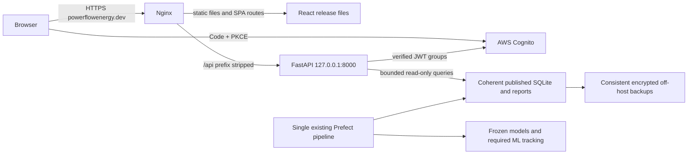

# Phase 5B.2 — AWS infrastructure preparation and staging readiness

> **Phase 5B.3 local follow-up:** Shared-helper extraction and equivalent chart-query optimizations are now implemented locally, with updated capacity scenarios and validation in [Phase 5B.3](phase5b3-capacity-and-streamlit-decoupling.md). They are not deployed; installed API identity, peak-load, backup/encryption and renewal gates remain open. Earlier extraction prerequisites below describe the migration plan and are now locally completed where that report specifies.


25 October 2026 (Africa/Nairobi). Branch `feature/react-frontend`. The checkout was later observed at baseline `74afaff`; no inference is made about who updated it. The agent performed no staging, commit, push, merge or Git history change. **Read-only inventory and design only: no infrastructure preparation commands were applied and Phase5B.3 has not started.**

## Decision and evidence boundaries

Target **React + FastAPI as the sole production web application at https://powerflowenergy.dev**, preferably on the existing EC2 instance after capacity/security/restore checks. Streamlit is preserved only through controlled migration and rollback, then retired after separate approval. Do not budget for a second permanently running web host. Use short-lived isolated staging only if needed to validate safely. Sections8–13 reflect the owner's updated decision and supersede earlier parallel-frontend roadmap assumptions.

Do **not** approve shared-host staging capacity from the low CPU figures alone. The approved SSH retry now verifies a point-in-time RAM/swap/filesystem/process/service snapshot (section2). Pipeline/import/query peaks and sustained load remain unmeasured. The existing instance is only2GiB RAM and its root volume is unencrypted. A same-host service user/cgroup limits a failure but does not remove the shared kernel/storage/IAM failure domain.

Fresh AWS reads succeeded after the owner refreshed the expired default login. Inventory was captured25 October around14:26UTC. Resource IDs/addresses/account numbers and credential-bearing fields are omitted. All saved summaries contain only selected non-secret fields; no S3 object contents, secret values, tokens, process environments or private keys were read. The owner subsequently approved the exact SSH bundle below. The first two connection attempts returned no host output; the bounded retry confirmed a network timeout. After the owner confirmed Terminal access and explicitly approved retry, the exact SSH bundle returned host evidence on25 October at17:25UTC (20:25Africa/Nairobi). No SSM inspection was performed. Current public TLS now validates; the prior Phase5A certificate-chain failure is historical, not a current verified outage.

Evidence categories: **AWS verified**, **public endpoint verified**, **SSH snapshot verified**, **repository/static test**, **historical acceptance**, and **proposal/unknown**. A source template is never treated as proof of an installed process. Account-global/regional discovery is scoped to this account/us-east-1; absence of one API resource does not prove all other backup/monitoring arrangements absent.

## Optional read-only host inspection — exact access boundary

The owner approved this exact bundle using the existing key through `ssh -i`, with no agent or SSH configuration changes. The verified target was the sole running EC2 address matching production DNS; `ec2-user` was established from the Amazon Linux deployment documentation and AMI evidence. The first two attempts failed before returning host data. A subsequent explicitly authorized retry succeeded and returned the host snapshot below. The combined remote shell exited1 with stderr present: the bundle is not an all-commands-passed result; individual exit codes were not captured. The final certbot timer query returned no stdout, so its enabled/missing/error state is unresolved. No extra commands or workaround were attempted. Use `StrictHostKeyChecking=yes`; stop if the host key is missing/mismatched. No key/password/code content should be sent in chat. Do not scan for private keys or assume root AWS access authorizes host commands. SSH authentication will create normal host audit/session records even though the commands are observational.

Authorized commands, submitted unchanged for the attempted short host session:

```bash
uname -sr
cat /etc/os-release
free -b
swapon --show --bytes --output TYPE,SIZE,USED,PRIO
df -B1 --output=fstype,size,used,avail,pcent /
vmstat 1 10
ps -eo comm,pcpu,pmem,rss --no-headers
ss -ltn
systemctl show powerflow-streamlit.service powerflow-prefect-server.service powerflow-prefect-worker.service powerflow-api.service postgresql.service nginx.service --property=Id,ActiveState,SubState,User,Group,MemoryCurrent,TasksCurrent,CPUUsageNSec
systemctl is-enabled certbot.timer
```

Expected effects: read OS counters/metadata, sample scheduler/swap for10seconds, list process names/resource usage without command arguments/environment, list listening sockets without process argv, and read selected service properties only. No restart/reload, package installation, schedule registration, write, production query, model run or data migration. Missing unit/timer is evidence, not a reason to create it. Process RSS summed across processes can double-count shared pages; one sample does not capture pipeline peak memory. Collect comparable counters during an already scheduled run, never trigger a run for the audit.

For Nginx, request an owner-sanitized routing/header/certificate-renewal summary rather than dumping `nginx -T`; config files can contain credentials. Do not print `.env`, secrets.toml, full `systemctl status`/journals, process args, certbot account files or private keys. Certificate public SAN/expiry can be inspected via the approved certificate path with `openssl x509 -noout -dates -ext subjectAltName`; the private key is excluded. Any need for sudo, additional paths or command changes requires separate scope review. The snapshot establishes current counters and selected unit states, not installed proxy contents, release provenance, renewal configuration or peak capacity.

## 1. Fresh AWS inventory

| Area | Verified25 October | Boundary / implication |
|---|---|---|
|Identity|Default CLI is root; expected account fingerprint matches prior audit|Accepted current read-only workflow risk; never an API credential or approval for privileged writes|
|EC2|One running t3.small in us-east-1f;2vCPU,2048MiB, EBS-optimized by default; public IPv4 and instance profile|AMI description/previous read identifies Amazon Linux2023 x86_64, but SSH now confirms Amazon Linux2023.12 and kernel6.18.48-109.150.amzn2023.x86_64; patch completeness is not established|
|Storage|One20GiB gp3 in use,3000IOPS/125MiB/s, **unencrypted**, root DeleteOnTermination=true|Disk allocation is not available filesystem space. Regional EBS encryption-by-default is **false**|
|Snapshots/backup services|No owned EBS snapshots; no AWS Backup plans returned in us-east-1|Does not rule out custom/on-host backups; neither is assumed|
|Subnet/routing|Public-address assignment enabled, main route table active0.0.0.0/0→internet gateway, local VPC route; no NAT gateway, no ELBv2 load balancer|Current host is internet-addressable; security groups provide the main inspected ingress restriction|
|Network ACL|Default ACL allows all IPv4 ingress/egress before final deny|No compensating port isolation from NACL. No ACL changes proposed on production|
|Security group|Public TCP80/443; SSH22 from one/32; no public IPv6 ingress shown|No inbound8000/8501/4200/5000/5432. SSH now verifies selected listening sockets in section2; SG rules do not alone establish host-firewall behavior|
|Egress|Attached SG permits all protocols to0.0.0.0/0|A service account alone cannot enforce outbound or metadata isolation|
|Metadata|IMDSv2 required, endpoint enabled, hop limit2|Positive control; does not prevent all code on a shared host obtaining the attached role|
|IAM role|No attached managed policies, two inline policies: scoped S3 list/location/read/version-read/put/delete/version-delete and scoped SSM GetParameter|No Resource:* in inspected statements. Fresh pattern check confirms DeleteObjectVersion Allow covers operational-backup prefix; not a full effective-policy simulation|
|Monitoring|Detailed EC2 monitoring disabled; no CloudWatch log groups or metric alarms returned; CWAgent metric namespace count0|Basic CPU/EBS metrics exist. No demonstrated remote app logs/backup-age alert. Another uninspected metrics source might exist|
|Access/audit|No SSM-managed instance and no configured CloudTrail trail returned|Not permission to install agents/use SSM. Event history may exist without a trail|
|S3|PowerFlow bucket all four public-access-block settings true; versioning enabled; default AES256/SSE-S3|No bucket policy (`NoSuchBucketPolicy`), no lifecycle (`NoSuchLifecycleConfiguration`), no Object Lock (`ObjectLockConfigurationNotFoundError`). Versioning is not deletion-proof retention|
|Operational backup prefix|Exactly two objects, non-truncated listing;6512640 and3416bytes; both last modified12 October14:07:58UTC|About13days old. Contents, matching manifest/hash and restore are **not** verified. No recent scheduled-backup success is established|
|DNS|A resolution matches current EC2 public address; NS are Name.com; no Route53 hosted zone|DNS host, not proof of registrar ownership or access. No DNS write performed|
|Cognito|Existing pool OPTIONAL/TOTP enabled; email then phone recovery; email verification-before-update list empty|General enrollment remains disabled in application; no email-update policy change|

Source summaries: `/tmp/pf5b2-inventory.log`, `/tmp/pf5b2-details.log`, `/tmp/pf5b2-permissions.log`, `/tmp/pf5b2-dns.log`. Initial expired-session results are excluded. All evidence is date-scoped; re-read before any future approved write.

## 2. Capacity assessment

Seven-day CloudWatch window ending25 October14:26UTC,168 hourly buckets:

| Measurement | Observed | What it does not prove |
|---|---|---|
|CPU utilization|Mean of hourly means3.19%; sample min0.87%, max45.47%|Not a percentile or per-process breakdown; doesn't cover future simultaneous inference/import peaks|
|CPU credit balance|Min575.56,max576|Recent spare burst capacity, not RAM availability|
|Surplus credits charged|Sum0 in this window|Not a guarantee of zero future unlimited-mode cost; current mode was verified unlimited in Phase5A, not changed here|
|EBS queue|Mean of hourly means0.00260; max observed0.598|No filesystem-free-space evidence or future contention guarantee|
|Read/write operations|734812reads /1466425writes summed over returned samples|Counts, not directly IOPS; do not label the metric's Max field as peak IOPS|
|Read/write total service time|426.97s /1436.42s|Using aligned aggregate counts gives ~0.581ms/read and0.980ms/write, not tail latency or application response time|
|RAM/swap/filesystem/processes|Not available in inspected CloudWatch namespace; **subsequently verified by SSH snapshot below**|Point-in-time counters do not establish peak-load headroom|

Latency derivation follows [AWS EBS metric guidance](https://docs.aws.amazon.com/ebs/latest/userguide/using_cloudwatch_ebs.html): sum total operation time divided by sum operations; sparse or unaligned windows require care. The aggregate window here matches the same168 hourly buckets; fine-grained percentiles were not measured.

### Approved host snapshot —25 October2026,20:25 Africa/Nairobi

The exact authorized SSH bundle returned the following. Local output capture time17:25:29UTC identifies the inspection approximately; no remote clock command was added. Earlier connection timeouts are historical failures, not the current inspection result.

| Host measurement | Verified result | Interpretation |
|---|---|---|
|OS/kernel|Amazon Linux2023.12.20260918; Linux6.18.48-109.150.amzn2023.x86_64|Actual running OS; no patch/security update audit performed|
|RAM|2,002,505,728bytes total (**1,909.74MiB**); available1,076,125,696bytes (**1,026.27MiB**, about53.7%)|One snapshot with reclaimable cache accounted for by MemAvailable; not a reservation or pipeline-peak measurement|
|RAM usage categories|Used651,382,784bytes; free619,679,744bytes; buff/cache731,443,200bytes; shared125,517,824bytes|Do not sum overlapping Linux accounting categories or equate free alone with available memory|
|Swap|4,294,963,200bytes total (about4GiB);857,128,960bytes used (**817.42MiB**)|Swap occupancy is material and could reflect prior pressure/inactive pages; it does not alone prove current thrashing|
|Root XFS|21,395,124,224bytes total;8,586,530,816used;12,808,593,408available (**11.93GiB**);41%used|Current free-space threshold passes at this instant; release/backup/snapshot workspace and future growth still need sizing|
|10-row vmstat|After the first since-boot aggregate, all9interval samples show si=0/so=0; idle97–99%,wa=0|No sustained swapping or I/O wait during this short idle observation. First row is not a fresh interval; no peak-load inference|

The requested `swapon` field restriction was not reflected in its displayed columns; the returned listing nonetheless agrees with `free` on swap size/use. No additional inspection or command changes were made. Only safe capacity totals are reproduced here.

| Selected systemd unit | State | Unit User / Group | MemoryCurrent bytes (MiB) | TasksCurrent |
|---|---|---|---:|---:|
|powerflow-streamlit.service|active/running|ec2-user / ec2-user|208,003,072 (198.37)|11|
|powerflow-prefect-server.service|active/running|ec2-user / ec2-user|220,143,616 (209.95)|10|
|powerflow-prefect-worker.service|active/running|ec2-user / ec2-user|336,973,824 (321.36)|7|
|powerflow-api.service|active/running|ec2-user / ec2-user|8,556,544 (8.16)|2|
|postgresql.service|active/running|postgres / postgres|240,934,912 (229.77)|14|
|nginx.service|active/running|blank / blank|7,827,456 (7.46)|3|

These are returned cgroup counters, not peak footprints or additional freeable RAM. RSS and cgroup accounting differ and may exclude swapped memory or double-count shared pages if summed. Nginx's blank unit User/Group does not identify its worker privileges; process ownership was outside the approved command fields. CPUUsageNSec values are cumulative, not current CPU demand.

Process-name snapshot also shows Streamlit RSS234,860KiB (**229.36MiB**), two Prefect processes, uvicorn RSS14,132KiB and multiple PostgreSQL processes. No clearly named MLflow server appears in the command-name list, but generic Python/uvicorn processes cannot be reliably attributed without arguments; do not claim MLflow absence. No environment or process arguments were inspected.

Listening sockets: **127.0.0.1:8000** (API candidate port already occupied), **127.0.0.1:4200** and **127.0.0.1:5432**; wildcard IPv4 ports22/80/443/**8501**, plus IPv622/80. A further ephemeral loopback listener is unattributed. Streamlit8501 is wildcard-bound, although inspected SG rules do not expose it publicly; no host-firewall or external reachability test was performed. Keep it protected pending decommission, and do not open its SG. Socket listing alone does not prove which process owns each port, proxy routing or installed API revision/security.

**API permission gap:** the running API unit uses **ec2-user**, not the proposed dedicated `powerflow-api` identity. This verifies a service-isolation gap; no secret access was attempted, and actual effective filesystem permissions/capabilities remain uninspected. Installed hardening does not follow automatically from repository templates. Migration must approve and validate the non-root dedicated account/read-only publication design before production readiness.

Source: exact-bundle stdout `/tmp/pf5b2-approved-host-output.txt` and `/tmp/pf5b2-host-meta.json`. No logs, configuration secrets, user records, credentials or key contents were inspected. The final certbot.timer query yielded no stdout and the shell exit was1; **renewal timer status remains inconclusive**, not disabled/absent by assertion. No sudo or altered command was used to resolve it.

Concurrent workloads are now directly observed for Streamlit, Prefect server/worker, PostgreSQL and API. Preserve the single scheduled writer; do not launch another scheduler, train models or assume MLflow needs internet hosting. The API-only target environment excludes MLflow/Prefect/scikit-learn, but framework-independent helper extraction remains a real endpoint-level packaging gate (section11).

Same-host risks: additional Pandas imports and per-worker Silver index compete with2GiB RAM; memory limit768MiB is an initial guardrail, not a reservation or proof remaining processes fit. Swap thrashing/OS OOM, shared EBS writes, same instance IAM, Nginx reload mistakes and VM failure affect production. A separate Linux user/container cannot eliminate these. **Shared-host staging is no-go without observed peak headroom, recovery evidence and explicit production-host change approval.**

Separate staging: one API worker + Nginx static SPA on its own encrypted disk, no pipeline/server stack, coherent read-only snapshot, no production write credentials. Initial t3.small remains a hypothesis until measured; stage t3.medium offers4GiB if needed. Proposed acceptance budgets: no OOM/restart, no sustained swap-in/out, ≥25% memory headroom under representative cold/warm concurrent reads, ≥25% filesystem free after releases/retention, and an agreed latency/error budget. These are proposed thresholds, not claims the current host meets them.

## 3. Backup and restoration plan — not applied

### Current evidence

Application backup tooling uses SQLite's online backup API, compacts **only the backup**, records hashes/schema/table metadata, checks integrity, protects local files and conditionally uploads timestamped object pairs. This is better than copying a live `.db`/WAL file blindly. Tooling and regression tests establish implementation behavior, not recovery of the13-day-old objects. Source S3 synchronization/versioning is not an application-consistent backup of all stores. No current restore demonstration or accepted RPO/RTO exists.

### Proposed coverage and retention

| State | Proposed consistent backup | Proposed retention / verification |
|---|---|---|
|Operational SQLite|Daily online backup + manifest, and before approved releases; atomically completed upload pair|14daily +8weekly copies; validate hash/size/schema/quick_check; alert age>26h|
|Raw/Silver/Gold/reports|Immutable published run manifest binding exact object versions/digests and source/forecast status|14daily reference points plus8weekly; latest input snapshot within one successful hourly publication interval. Source outage doesn't justify inventing a new point|
|Frozen models/contracts/evaluation|Preserve approved release artifacts and hashes, never regenerate during backup|All active/rollback releases and independently verified archive; reject untrusted joblib artifacts|
|MLflow|Consistent MLflow SQLite backup plus referenced artifacts (or actual installed backend's supported backup)|If production research state exists, daily metadata + complete referenced artifact set; don't back up an assumed nonexistent server|
|Prefect PostgreSQL|Consistent supported PostgreSQL backup plus deployment definitions/version|Daily + pre-change; restore separately from operational SQLite. Do not put credentials in manifests|
|OS/release configuration|Encrypted EBS recovery points plus approved non-secret deployment manifests and a secure secrets-recreation inventory|7daily +4weekly snapshots as a proposal; model/release config reproducible independently of the VM|
|Secrets/identity|Use existing approved secrets store/access policy, not plaintext in source/S3 manifests|Private keys/passwords/tokens excluded; restricted encrypted recovery procedure and audit needed before any configuration export|

Initial proposed targets: SQLite/Prefect/MLflow metadata RPO≤24h, published-data recovery point≤one successful scheduled publication interval, full clean-host RTO≤2h after a usable recovery set is selected. These are **unaccepted/unmeasured objectives**. Hourly publication pointers do not mean every intermediate data version is retained unless the retention implementation provides it; decide cadence/storage costs explicitly.

Separate responsibilities: backup writer gets append-only PutObject to backup prefix, no delete/version-delete; restore reader gets approved versions only; retention/recovery operator is separate and time-bound. The present pipeline role can delete backup versions, so existing S3 versioning is insufficient against compromised writer credentials. Review prefix separation and temporary-upload cleanup before narrowing existing production policies. Object Lock would add irreversibility/legal/retention tradeoffs; do not enable it casually or claim it is required for initial staging. No role, lifecycle rule, bucket or snapshot was changed.

### Restore acceptance procedure — separate approval before execution

1. Select a complete approved immutable backup set by version/digest and run ID; verify both manifest and data exist. Do not publish operational paths/credential-bearing manifest fields.
2. Restore into a separate encrypted disposable host/path with no production write credentials/scheduler. Do not overwrite existing data or execute a live pipeline.
3. Check cryptographic hashes, size, SQLite integrity/schema/counts, PostgreSQL supported checks, model hashes/features, report chronology, freshness/WITHHELD metadata and cross-file consistency. Preserve historical timestamps; never relabel restored data live.
4. Start only isolated read-only application services and compare selected values/counts/model provenance to the manifest. Test unavailable/withheld states too. No Cognito profile change/recovery/enrollment is part of this drill.
5. Record elapsed restore time, achieved recovery point, sanitized errors and approver. Destroy disposable resources only with cleanup approval. A passing synthetic unit test alone is not restore evidence for the real backup.

Stage data transfer itself requires approval: approved non-sensitive market/model summaries only, no production secrets/user logs; generate a consistent snapshot through reviewed backup/publication tooling, not `rsync` of a busy SQLite/WAL directory. Keep the production writer as the only writer.

## 4. Separately approvable EBS encryption remediation

AWS supports encryption via a new encrypted resource, not an in-place conversion of this existing volume. Recommended conventional approach: application-consistent snapshot → encrypted snapshot copy → encrypted replacement volume in the instance's AZ. See [EBS snapshot copying](https://docs.aws.amazon.com/ebs/latest/userguide/ebs-copy-snapshot.html), [encryption examples](https://docs.aws.amazon.com/ebs/latest/userguide/encryption-examples.html), and [replacement volumes](https://docs.aws.amazon.com/ebs/latest/userguide/ebs-restoring-volume.html). No commands below were performed.

1. **Preflight approval:** identify exact existing root volume/instance, AZus-east-1f, boot/root device mapping, size/type/IOPS/throughput, filesystem identifiers/fstab, source data versions and required downtime. Confirm KMS access, operator permissions and old-volume retention. Instance type is compatible in principle; actual boot/mount state requires host inspection/rehearsal.
2. Make/validate independent application backups first (SQLite, actual Prefect DB, any actual MLflow state and release/artifact references). Capture non-secret instance/volume mapping and delete-on-termination settings. Don't claim a root snapshot substitutes for application consistency.
3. Separately approve a maintenance window, drain ingestion, prevent a scheduled worker starting, and cleanly stop affected services/instance. This changes production behavior and is **not authorized now**. AWS [snapshot guidance](https://docs.aws.amazon.com/en_en/ebs/latest/userguide/ebs-creating-snapshot.html) recommends stopping an instance for root-volume snapshots. Do not force-detach a mounted live root.
4. Create the source snapshot, wait for completion, create an encrypted copy explicitly using an approved EBS key (proposal `alias/aws/ebs` for simple same-account use), wait/verify encryption/completion. Source snapshot is initially unencrypted and sensitive; tightly restrict and define separately approved cleanup. Enabling default encryption alone does not convert existing storage.
5. Create a20GiB-or-larger encrypted gp3 replacement in the sameAZ, matching required performance. Preserve root mapping; detach the old root **only while stopped**, attach replacement with reviewed original device mapping. No change to application schema/model features. Nitro guest device naming and filesystem identifiers must be verified, not guessed from console names.
6. Start only after approved mapping checks; validate boot/filesystems, data hashes, DB integrity, service bindings/health, pipeline schedule state, forecast freshness labels and Streamlit login. Don't silently trigger training/ingestion to conceal an incomplete restore.
7. If boot/readiness/integrity fails, stop and reattach the retained original root using the recorded mapping. Reconcile any writes accepted on the replacement before rollback; application traffic/pipeline must stay drained until the acceptance decision. Snapshot creation/copy is not guaranteed instant; reserve a maintenance window after a rehearsal, not an invented outage duration.
8. Keep old volume/source snapshot for an explicitly approved rollback interval (propose 7 days); deletion is a **later explicit action**, not automatic. Original unencrypted data remains a residual risk during retention. Never disable/delete the KMS key as a rollback method.

Alternative: a new encrypted host with validated application restore/cutover can reduce stop-and-swap risk but adds parallel infrastructure/DNS/application transition and must not be bundled into staging approval. AWS also documents newer volume-copy tooling; it still creates a new resource and does not remove application-consistency/boot/cutover requirements. Choose one reviewed method, not a failed-operation workaround.

Cost: second20GiB gp3 while retained ~+$1.60/month-equivalent; snapshots charged on stored incremental blocks, encrypted copy may incur a full copy. At an illustrative standard snapshot rate$0.05/GB-month, two fully stored20GB sets would be~$2/month, not a quote or guarantee of actual stored bytes. No fast-snapshot-restore provisioned. Customer-managed KMS keys add pricing/access-lifecycle considerations; default-key choice and any cross-account plan require review. [Snapshot pricing](https://docs.aws.amazon.com/ebs/latest/userguide/snapshot-archive-pricing.html). No snapshots, volume changes, stops or KMS changes occurred.

## 5. Network, TLS and staging hostname design

Fresh normal-trust public checks (no insecure certificate bypass, credentials or cookies):

- TLS1.3 negotiation and certificate chain/hostname validation succeeded. Issuer Let's Encrypt YE1. Certificate valid25 September05:17:27UTC through24 December05:17:26UTC2026; SANs **powerflowenergy.dev and www.powerflowenergy.dev only**, no wildcard/staging SAN.
- HEAD `/` returned200, HTML, Server header nginx/1.30.4 and Cache-Control:no-cache. HSTS, CSP, X-Content-Type-Options and X-Frame-Options were absent on this response. This is observed header evidence, not proof of binary version or every route's policy.
- HTTP root returned301 to HTTPS same hostname/root. HEAD `/api/health` returned405; a subsequent safe GET returned200, JSON, application PowerFlow API/statusok. Thus an existing public `/api/health` route is reachable; this does not prove the deployed API revision/authentication settings or authorize replacing it.
- DNS matches the verified EC2 address and is hosted by Name.com. Proposed **staging.powerflowenergy.dev** must be checked for conflicts before any approved record creation: staging-specific A/AAAA/CNAME lookups timed out, so existence is **inconclusive**, not absent. An earlier simplistic count included a DNS diagnostic line; parsed answer checks do not establish a real CNAME.

**Existing production certificate does not cover staging.** Propose a separate staging A record to a separately approved staging EIP and separate certificate for the exact staging name. Preserve apex/www records and certificate untouched. Prove ownership/issuance/renewal on the new host; no production Nginx reload or certificate expansion is implied. Valid current TLS is a positive result, but renewal automation and installed routes remain unverified because no host config dump was authorized/performed.

### Proposed staging reverse-proxy policy — not installed

- New staging server block serves SPA only on the proposed staging hostname; TLS 1.2/1.3, approved certificate/renewal, HTTP80 for redirect/approved ACME validation only. Reject unknown hosts. No inbound8000/8501/4200/5000/5432; SSH restricted to an approved operator/32 (or separately approved management channel).
- FastAPI binds127.0.0.1:8000. `/api/` strips prefix and forwards to that loopback upstream, preserving approved Host and controlled forwarding headers. Public browser same-origin `/api` needs **no CORS**. API allowed hosts: `staging.powerflowenergy.dev,localhost,127.0.0.1`; no wildcard or reliance on arbitrary client forwarding headers.
- Client body limit16KiB, upstream connect timeout3s/read-send timeout35s, explicit keepalive and connection caps. Initial per-IP API budget5r/s with burst20, separate sensitive-account budget1r/s/burst5, return429 rather than retry mutations. These are proposed starting values, not measured safe limits. Shared NAT users/polling pages require load tests and tuning before activation.
- Readiness is local/management-only; do not automatically publish `/api/ready` through catch-all proxy. Probe127.0.0.1:8000/ready locally with an allowed host. Existing cheap liveness may be exposed under approved staging policy; health is not source freshness or live Cognito availability.
- API errors/404s must never return SPA HTML; SPA history fallback covers seven routes and `/auth/callback`, not `/api` or missing content-hashed assets. Index/config no-cache, versioned hashed assets immutable; keep prior assets during rollback.
- Add nosniff, frame denial, no-referrer and staged CSP/report-only validation. Limit script/font origins to self and connect destinations to exact approved Cognito/API origins; account for Recharts inline styles without permitting arbitrary inline scripts. HSTS should be scoped to the new validated hostname initially, not an unreviewed includeSubDomains policy. Existing production headers unchanged in this phase; section10 proposes reviewed controls for the final cutover.
- Proxy logs must omit query strings, auth headers, cookies, request bodies, raw callback URLs and user-controlled paths. Correlate fixed status/timing with the API's generated request ID; do not copy caller IDs or raw errors. Define bounded journald/proxy retention and owner; don't create an external telemetry pipeline without approval.

## 6. Linux service and filesystem model

Use the existing **proposal** at `deploy/staging/powerflow-api.service`; this phase does not install/change it. Root-owned immutable releases under `/opt/powerflow`, dedicated `powerflow-api` user/group (no sudo/login role), API-only `.venv-api`, public configuration `/etc/powerflow/api.env`, coherent published tree `/srv/powerflow/published`. Only source/venv directories need execute; published CSV/JSON/SQLite/manifests need read, not write. Parent-directory traversal and any SQLite WAL/SHM read semantics must be tested on Linux. Never solve permissions with chmod777, root service execution or production ingestion credentials.

Template: one worker, loopback-only proxy trust, no raw access logs, NoNewPrivileges, strict filesystem/home protections, read-only data, empty capabilities, private tmp/devices, TasksMax64/MemoryMax768MiB/CPUQuota100%, concurrency32 and20s graceful stop inside30s systemd stop. These controls are guardrails, not proof of memory fit or effective IAM isolation. A shared host still exposes its instance role through metadata unless appropriately isolated; separate staging should use no production role and no root credentials.

Separate staging receives approved read-only snapshots, not a mounted writeable production database or another pipeline. No Prefect/MLflow/model service is installed merely because those exist in the repository. API lock excludes those packages and was tested on macOS in5B.1; **Linux x86_64 clean install and actual systemd sandbox validation remain mandatory**. API/research/orchestration dependencies must not be merged.

Local checks this phase:26 existing deployment-template/runtime tests passed; whitespace checks passed. `systemd-analyze` is not available on this macOS host. No Docker engine/container/systemd service was started and no remote Linux installation was performed. These static tests do not establish installed sandbox equivalence or peak resource behavior. The subsequent SSH snapshot establishes selected active units and their reported User/Group; notably the installed API uses ec2-user rather than the proposed dedicated identity.

## 7. Cognito staging requirements and exact proposal

Fresh read-only configuration confirms existing React client is localhost5175-only, code flow, COGNITO+Google, scopesopenid/email/profile/self-service,60min access/ID and5day refresh, revocation enabled. Streamlit remains on its separate client with production `/oauth2callback` and original logout. No existing client is edited. Pool remains OPTIONAL/TOTP, email-based native sign-in/recovery policy unchanged.

Current Google mapping is `{email:email, email_verified:email_verified, name:name, username:sub}`. Mapped mutable email/name must remain compatible with client permissions; username is provider-controlled, and email_verified is not a normal client-writable attribute. **Do not grant email_verified/group/identity-ID writes** to satisfy federation. See [client permissions](https://docs.aws.amazon.com/cognito/latest/developerguide/user-pool-settings-client-apps.html) and [mapping rules](https://docs.aws.amazon.com/cognito/latest/developerguide/cognito-user-pools-specifying-attribute-mapping.html). Google refreshes mapped name on sign-in; preferred_username stays a presentation label, never a role.

### Proposed initial read-only staging client — requires separate approval

Create one new public SPA client in the existing pool, named `powerflow-react-staging`; **do not update either existing client**:

| Setting | Proposed value |
|---|---|
|GenerateSecret|false|
|AllowedOAuthFlowsUserPoolClient / flows|true / `[code]`; browser sends S256 PKCE and nonce/state|
|Providers|`[COGNITO,Google]`, existing provider mapping unchanged|
|CallbackURLs / default redirect|`[https://staging.powerflowenergy.dev/auth/callback]` / same exact URL|
|LogoutURLs|`[https://staging.powerflowenergy.dev/]`|
|Initial OAuth scopes|`[openid,email,profile]` only for auth/read-only analytics acceptance|
|Readable attributes|`[email,email_verified,identities,name,preferred_username,sub]`|
|Writable attributes|`[email,name,preferred_username]`, matching proven limited SPA federation/required-email permissions; no verification/group writes|
|Access/ID validity|15minutes each; refresh1day, explicit units|
|Token revocation / user-existence errors|enabled / ENABLED|
|ExplicitAuthFlows|ALLOW_REFRESH_TOKEN_AUTH only; no custom/direct password implementation, managed login owns native password/TOTP|
|Refresh rotation|Not enabled in this initial proposal; review independently rather than silently change the existing session design|

New stage API issuer remains the verified pool issuer; client allowlist contains **only the new staging client ID**, not a wildcard or all existing clients. Leave resource audience unset unless explicitly configured resource binding is separately approved. Browser settings use that new ID/exact HTTPS callback/logout. Google uses the pool's existing federation callback; a new React origin alone is not permission to edit Google OAuth credentials/mappings.

Initial proposal intentionally does **not** grant `aws.cognito.signin.user.admin`. Full profile management requires that reserved scope and permits broader direct Cognito self-service than the two app form fields. If full account-management staging acceptance is desired, request a second explicit scope/test-account approval first; UI must report unavailable account settings honestly, not fake success or keep requesting an unsupported scope. Existing production/local SPA scopes remain unchanged. Do not mistake initial limited-profile staging behavior for completed full account-management acceptance.

A separate client isolates redirects/token binding, **not users/groups/federation updates**. Google sign-in may refresh mapped fields in the shared identity; native refresh/recovery/password changes affect shared accounts. No live authentication/account test is authorized by this planning phase. Future tests must explicitly designate accounts/actions; no profile edits, recovery, native account creation, linking, MFA enrollment/removal or role changes are implied. An isolated staging pool with separately approved test identities/provider setup is the stronger alternative before testing self-service writes; it costs/configures more and would be another approval packet, not a hidden addition.

Future acceptance: Google provider compatibility, native Analyst and already-enrolled test user's hosted TOTP challenge, callback and expiry/sign-out, invalid issuer/client/audience rejection, all seven restricted report denials. Roles stay exclusively verified Cognito groups; no frontend role trust. Application enrollment flag remainsfalse, and pool-level OPTIONAL is not a promise of lost-device recovery or a universal ban on direct self-service enrollment through other already-approved clients.

## 8. Final production architecture and capacity decision

**Decision update,25 October2026:** React + FastAPI is the sole intended production web application at **https://powerflowenergy.dev**. Streamlit is a temporary migration/rollback dependency, not a second permanent frontend. This supersedes the earlier recommendation for ongoing parallel web applications or a different final React hostname. No services or infrastructure were changed by this decision.

Preferred steady state: existing EC2, Nginx serving prebuilt React files, one non-root loopback FastAPI worker, the single existing ingestion/forecast/publication pipeline, and required Prefect/database processes. Preserve SQLite, frozen models, evaluation/anomaly reports, MLflow metadata/artifacts and required tracking functionality. Do not assume MLflow needs an always-running public UI: the repository shows research tracking, not a verified need for a production MLflow server. Confirm usage before changing any such service.



The diagram describes the analytics read path; existing authenticated self-service account operations call Cognito and must retain their current controls. No new administrative credentials or endpoints are implied.

### Can the existing t3.small host the replacement?

**Supported as the preferred candidate by an actual idle snapshot, not yet proven safe under load.** The successful SSH retry shows about1.00GiB available RAM,11.93GiB disk available and no swap-in/out in9interval samples while the six selected services run. About817MiB swap is occupied, so prior pressure/inactive swapped pages and future cold reads remain concerns. React has no production Node/Vite server: build off-host and serve static assets. Streamlit currently reports about198MiB cgroup memory and229MiB RSS; stopping it later may free some memory, but neither counter is a guaranteed incremental saving.

Keeping25% of actual RAM as a proposed reserve leaves only about549MiB of the observed available RAM for **incremental** demand before that reserve is consumed. This is not a safe API allocation: a768MiB cgroup ceiling could exceed it, and the existing API process is not proven to represent the new release's data-loaded footprint. Measure total steady-state and overlap load before choosing limits. The observed existing API on8000 must be treated as a live service, not an unused staging port; any release replacement or separately approved alternate loopback port needs an explicit deployment plan.

Two capacity gates must be measured separately:

1. **Temporary overlap:** existing Streamlit + private candidate API during read-only validation, including an already scheduled pipeline run. If overlap cannot meet resource limits, use a short-lived isolated staging host; do not stop production to discover whether the candidate works.
2. **Replacement steady state:** Nginx + API + required pipeline/Prefect/SQLite/ML services, with Streamlit stopped only in an approved rehearsal/cutover window. Retain at least25% memory and disk headroom as a proposed acceptance threshold, no OOMs or sustained swap-in/out, and acceptable API latency/error rates during representative load and scheduled peaks. A cgroup memory cap is not proof of fit; tune the proposed768MiB API cap against total host requirements.

Do not trigger training/forecasts for this audit. Use scheduled workload observations or isolated representative tests. A single host remains a failure domain and requires recoverable off-host backups. If t3.small fails measured steady-state checks, price a **replacement/resize of the one production host**, not a second permanently running frontend. A t3.medium costs roughly$35.62/month for compute/disk/IPv4 before backups and monitoring; that misses the preferred$30–35 total and needs explicit budget/security/maintenance approval. No resize is authorized now.

### Hosting comparison

| Option | Incremental recurring cost | Decision |
|---|---:|---|
|Reuse existing EC2 for final React/API, retire Streamlit after validation|$0 additional host; current resource baseline$20.43/month|Preferred if capacity, storage security, restore and auth gates pass. Shared pipeline contention remains.|
|Temporary t3.small staging then remove after separately approved acceptance|$0.0258/running hour plus retained storage; see section9|Fallback for safe isolation during overlap; never silently convert into permanent dual hosting.|
|Second t3.small kept continuously alongside production|$20.43/month extra before other usage|Unnecessary steady-state duplication under the new decision; reject as default.|
|One t3.medium replacing existing host|About$35.62/month baseline, no second permanent host|Only if measured resource demand requires it and total cost fits the confirmed budget.|
|Lightsail or CDN/static-host/API split|Not selected|New access/network/backup/routing complexity and migration risk; static files are not the memory bottleneck. Review separately only if EC2 evidence defeats the preferred option.|

Price evidence: fresh AWS Pricing API t3.small Linux us-east-1$0.0208/hour and t3.medium$0.0416/hour; gp3$0.08/GiB-month at included baseline; IPv4$0.005/hour. Assumes730hours/month,20GiB and one IPv4. [EBS](https://aws.amazon.com/ebs/pricing/), [IPv4](https://aws.amazon.com/vpc/pricing/). Prices exclude usage-dependent charges; removing Streamlit does not itself reduce EC2 hourly billing.

## 9. Actual billing, credits and two-month spending envelope

Read-only Billing `GetCredits` and one Cost Explorer `GetCostAndUsage` request succeeded25 October14:53UTC. Query covered1 September through24 October inclusive (exclusive end25 October), grouped by service and charge type; no pending pagination. No billing feature was enabled. Cost Explorer requests cost$0.01/page, so this inspection adds a small charge that may appear later. [Query pricing](https://aws.amazon.com/aws-cost-management/aws-cost-explorer/pricing/).

### Verified credit position

| Enabled USD promotional credit | Initial | Remaining (finalized billing basis) | Estimated remaining, including open bills | Expiration, Africa/Nairobi |
|---|---:|---:|---:|---|
|Credit A|$100.00|$92.12|$75.25|19 September2027,10:03:28|
|Credit B|$20.00|$20.00|$20.00|19 September2027,10:04:06|
|Total|$120.00|**$112.12**|**$95.25**|Both extend beyond the next two months|

Use the **$95.25 estimated** balance for planning, not$112.12. This confirms the owner's approximately$95 estimate; it is not a promise of future coverage. Both credits are ENABLED with no purchase-type restriction returned. Their applicable-product lists explicitly include Amazon Elastic Compute Cloud, Amazon Virtual Private Cloud, Amazon Simple Storage Service, AWS Backup, AmazonCloudWatch, Amazon Cognito, AWS Key Management Service, AWS Cost Explorer and AWS Data Transfer. This establishes relevant service eligibility, not that every possible tax/Marketplace/support/domain charge is covered. No account or credit identifiers are published here. [Credit API and field meanings](https://docs.aws.amazon.com/cli/latest/reference/billing/get-credits.html).

### Actual account spending

| Period | Usage before credits | Applied credits | Net after credits | Evidence |
|---|---:|---:|---:|---|
|1–30 September2026|$7.4911|-$7.4911|Approximately$0|Finalized Cost Explorer period; not a full month of continuous current resources|
|1–24 October2026|$16.8031|-$16.8031|Approximately$0|Estimated/open period, tax returned$0; usage still consumes credits|

October service breakdown before credits: EC2 compute$11.9808; VPC$2.8800; EC2–Other$1.2358; S3$0.7065; Secrets Manager$0.00006. Cognito/CloudWatch returned zero for this query; this does not guarantee future free usage. EC2–Other is not disaggregated into every storage/transfer item by this query. Account totals are not a resource-tag allocation; they include any other account usage. Credit groups may be assigned across services, so do not infer eligibility from a one-to-one service-row offset. Rounding differences below one cent are not money owed.

A simple24-day extrapolation to730hours is about$21.30/month, not a billing forecast: billing lag, instance uptime, storage growth and new security controls can change it. [Cost Explorer cost semantics](https://docs.aws.amazon.com/aws-cost-management/latest/APIReference/API_GetCostAndUsage.html). Source: sanitized `/tmp/pf5b2-billing-summary.json`; no credentials, tokens or account IDs selected. Future changes must refresh balances and recent spend, rather than rely indefinitely on this dated report.

### All-in planning allowances — not configured limits or quotes

Target **$30–35/month total**, with$47.50/month a hard planning maximum average against the owner's$95 envelope. Verified$95.25 would imply$47.625/month, but do not spend that rounding buffer. Budget consumption is gross eligible usage before credit offsets, not the near-zero net bill.

| Component | Monthly allowance | Basis / uncertainty |
|---|---:|---|
|One t3.small compute|$15.18|730 ×$0.0208; surplus-credit charges not included here|
|20GiB gp3 production disk|$1.60|Baseline performance, no disk expansion assumed|
|One public IPv4|$3.65|730 ×$0.005; stopped/idle allocated IP can still be billed|
|S3 datasets, retained versions, application/config backups and requests|$2.00|Planning allowance above observed October usage; enforce retention only after approval. Total retained bytes and request growth not measured.|
|EBS snapshots|$2.00|Illustrative40GB stored at$0.05/GB-month. Snapshot billing follows retained incremental blocks, not count×full disk size; proposed retention may exceed allowance if churn is high.|
|Monitoring/logging/alerts|$2.00|Proposed minimal RAM/disk metrics, small alarm set and bounded sanitized logs; final meter/retention design must fit this. No paid dashboard/high-cardinality telemetry.|
|TLS certificate|$0 certificate fee|Existing Let's Encrypt; renewal/access still needs host verification. Domain renewal and operator work separate.|
|Cognito/API calls/egress/other eligible usage|$2.00|Allowance, not guaranteed free; no SMS/recovery or training burst introduced.|
|Steady-state planning subtotal|**$28.43**|Before contingency; each variable allowance needs measurement and tracking|
|Contingency|**$3.00**|Storage growth, query costs and short migration overlap; not a guaranteed cap|
|Steady-state planning total|**$31.43/month**|**$62.87 for two730-hour months**, rounded|

[CloudWatch meters](https://aws.amazon.com/cloudwatch/pricing/), [S3 pricing](https://aws.amazon.com/s3/pricing/), [snapshot pricing](https://aws.amazon.com/ebs/pricing/), [free Let's Encrypt certificates](https://letsencrypt.org/). Allowances deliberately do not assert free-tier eligibility or an unmeasured backup size. Reconcile actual retained versions/snapshot blocks/log volume weekly; increase the estimate or reduce optional staging duration if they exceed budget, never silently discard recovery safeguards.

Temporary staging examples, **added once** to the two-month steady-state total:

- **48running hours then approved full cleanup:** compute$0.9984 + IPv4$0.24 +20GiB gp3 prorated48/730≈$0.1052 = **$1.34**, before staging snapshots/data/traffic. Working total≈**$64.21**, leaving≈$31.04 of verified estimated credits.
- **14continuous days then approved full cleanup:** compute$6.9888 + IPv4$1.68 + disk≈$0.7364 = **$9.41**, before variable staging extras. Working total≈**$72.27**, leaving≈$22.98. Target an additional$2 staging variable-cost allowance, total≈**$74.27**, average$37.14/month: above preferred range but below$47.50 maximum.
- Stopping alone is not cleanup: retain staging disk/IP for two months and336running hours costs about**$17.49**, before extras. Continuous dual-host operation adds$40.87 over two months, bringing the$62.87 plan to≈**$103.74**, exceeding$95 even before staging extras; not recommended.
- A single t3.medium adds$15.18/month to the small-host plan:≈**$46.62/month/$93.24 two months**, before temporary staging, leaving only≈$2 of verified credits. This is too close to the maximum for a secure contingency; seek additional funding or revise the measured workload before approval.

Temporary encrypted-volume retention for remediation adds$1.60/month per extra20GiB plus snapshot-copy blocks; allocate from contingency only if sufficient, otherwise approve extra budget. No customer-managed KMS key fee assumed; key choice is a separate decision. Do not charge backup storage twice between application S3 and EBS snapshots: these are distinct recoverability layers. Off-account DNS/registrar fees and noneligible charges require cash outside credits. No AWS budget/alarm/lifecycle was created. A cost threshold alert and named weekly reviewer are future approval items, not enforcement already in place.

## 10. Production domain, Nginx and Cognito cutover proposal

### Final routing — not installed

Keep **powerflowenergy.dev** and current HTTPS entry point. If the existing EC2/EIP is reused, **no apex DNS change is planned**. Verify current record/address and renewal before change. Current certificate covers apex/www; no new production hostname certificate is inherently needed. Any `www` alias must redirect to the canonical apex before authentication, rather than add unneeded callback variants. Temporary staging DNS/certificate is optional and separately approved; loopback/local preview is preferable where sufficient.

Proposed production Nginx behavior:

- `/` and seven React routes use versioned static release files with SPA history fallback; `/auth/callback` returns the React entry document. Index/public config no-cache, hashed assets immutable and missing assets404 rather than HTML. No production Vite/Node process.
- `/api/` goes to127.0.0.1:8000 with the actual backend prefix stripped. Verify existing public `/api/health` and consumer routes remain compatible; preserve authorization on restricted legacy monitoring aliases. No raw public API port, permissive CORS or SPA fallback for API errors.
- Apply section5 body/rate/timeouts/header controls after actual request tests. API production mode, allowed hosts `powerflowenergy.dev,localhost,127.0.0.1`, exact approved client binding and enrollment-disabled flag. Same-origin browser requests need no CORS. Management readiness stays private.
- `/oauth2callback` and Streamlit websocket/health routes are legacy rollback concerns. Keep their known-working proxy configuration in the saved rollback release. Do not point a legacy callback into React or silently treat a Streamlit session as a React session. After cutover, expired in-flight legacy login may require a clear fresh sign-in; define this in the maintenance notice.
- Validate `nginx -t` and staged routes before the separately approved graceful reload. Never replace unknown installed routing from an unverified template. No reload is performed in this audit.

### Production Cognito proposal — approval required, no settings changed

Prefer a **new public production SPA client**, named `powerflow-react-production`, in the existing pool, leaving the current localhost React client and original Streamlit client unchanged throughout rollback. Reusing the development client is an alternative requiring a separate explicit update; mixing localhost and production is not the preferred isolation boundary.

| Setting | Current React / Streamlit | Proposed new production SPA |
|---|---|---|
|Callback|React `http://localhost:5175/auth/callback`; Streamlit localhost8501 and `https://powerflowenergy.dev/oauth2callback`|**Only `https://powerflowenergy.dev/auth/callback`**, default redirect same|
|Logout|React `http://localhost:5175/`; Streamlit `https://powerflowenergy.dev/`|**Only `https://powerflowenergy.dev/`**|
|Secret / flows / providers|Separate clients; React public code flow, COGNITO+Google|GenerateSecret=false; OAuth enabled/code; COGNITO+Google; S256 PKCE/state/nonce in React|
|Scopes|React openid/email/profile/self-service; Streamlit openid/email/profile|`openid,email,profile,aws.cognito.signin.user.admin` to retain already implemented profile/password functionality; requires explicit approval for the new client, not implied by existing scope approval|
|Read attributes|Current restricted React allowlist|`email,email_verified,identities,name,preferred_username,sub`|
|Write attributes|Current React `email,name,preferred_username`|Same proven limited allowlist; no group/verification/identity-ID writes. Email update UI remains unavailable pending separate policy approval.|
|Validity / revocation|React access/ID60minutes, refresh5days; revocation enabled|Match60minutes/5days with explicit units and revocation enabled for initial compatibility; any shorter TTL/rotation change requires separate review|
|Auth flows / existence errors|React ALLOW_REFRESH_TOKEN_AUTH,ALLOW_USER_AUTH,ALLOW_USER_SRP_AUTH / ENABLED|Preserve same proven React values on the new client; managed login handles passwords/TOTP, no custom password implementation|

Production API trusts the same verified pool issuer and **new production client only** for React tokens; inventory any legitimate API consumers before excluding their approved clients. Do not add the Streamlit ID blindly: it reads data directly today. Keep group-derived roles server-side; account self-service scope is not Admin permission. Google mappings remain unchanged and must be read-back checked against the new allowlists before creation. Saved settings for both original clients remain intact for rollback. Production React built with new exact public settings; no browser client secret. Confirm callback/logout/state handling on the real canonical origin during separately approved acceptance.

The new client still shares existing identities, groups and pool-wide MFA. Existing accounts are not staging fixtures. No account edits, password recovery, identity linking, MFA changes or provider changes are authorized by this proposal. General-user enrollment remains disabled and lost-device recovery remains unverified. A future retirement of the obsolete Streamlit client is a **separate decommission approval after rollback expires**, not part of client creation/cutover.

## 11. Streamlit retirement inventory and shared-code boundary

Repository inventory plus selected active-unit/socket evidence from section2; installed file contents and dependencies remain unverified. **Delete nothing in this phase.**

| Candidate | Eventual action after validation and approval | Preserve / prerequisite |
|---|---|---|
|`deploy/systemd/powerflow-streamlit.service`, installed corresponding unit/process/8501 listener|Stop/disable only after approved routing cutover; remove unit/service later at decommission|Retain original unit, interpreter and configuration during rollback. Its active/running state and wildcard8501 listener are now verified; exact unit contents/release remain uninspected.|
|`src/dashboard.py`, `src/legacy/dashboard_old.py`|Retire Streamlit rendering/navigation and legacy UI after parity and reference checks|Keep all genuine market/forecast/anomaly/evaluation/operational functions in React/API; preserve historical evidence where required.|
|`src/dashboard_data.py`, `src/dashboard_health.py`|**Extract shared logic first**, then remove Streamlit cache decorators/adapters and UI-only remainder|API lazily imports `build_model_input_context`, `summarize_clean_price_history`, `model_performance_state`, `assess_operational_health`, `source_freshness_state`, `latest_quality_state`. Current modules import Streamlit; deleting them breaks real requests even if startup passes.|
|`src/auth.py`, `scripts/check_auth_configuration.py`, `scripts/generate_auth_password_hash.py`|Retire Streamlit OIDC/local-password/session adapters and obsolete tooling after import/reference audit|Keep FastAPI security, Cognito self-service boundaries and React OIDC. Do not accidentally remove shared secrets helpers. Existing local-user configuration must not be copied into React.|
|`.streamlit/config.toml`, `.streamlit/secrets.toml.example`, installed Streamlit secrets/cookie settings|Remove application-specific settings only after rollback period and separate secret-retirement plan|Never inspect/print secrets here, destroy rollback credentials early, or remove shared pipeline secret delivery.|
|`requirements.txt`, `requirements-prod.txt` Streamlit pins; full transitive dependencies|Regenerate separated dependency manifests/locks after shared-helper extraction|`streamlit` is removable only then. Authlib/Altair/PyDeck/Plotly are **candidates**, not blanket deletions: prove no research/API/other consumer needs them. Keep pandas/numpy/scikit-learn/joblib/ENTSO-E/Prefect/boto3 and other genuine runtime dependencies as required.|
|`Dockerfile`, `docker-compose.yml` dashboard service/8501 exposure|Replace Streamlit image entry point/build context or remove dashboard-only service after approved packaging review|Compose MLflow and Prefect currently build the same Dockerfile; do not delete the shared image/build path blindly. Harden secrets exclusion before any build.|
|`scripts/benchmark_dashboard.py`, `scripts/check_production_imports.py`, dashboard/auth tests and CI assertions|Retire UI-only benchmarks/tests; replace import/runtime checks with API/pipeline tests|Preserve calculation assertions from `tests/test_phase4c.py` and dashboard data/health tests against extracted shared modules. Test endpoints with genuine fixture data, not startup alone.|
|Production Nginx Streamlit websocket/callback proxy blocks, old environment entries and old Cognito client|Remove only after signed-off stabilization, rollback expiry and separate account/configuration approval|Keep apex TLS, `/api` contracts, active React client, public domain and trusted JWT rules. Do not delete generic upstream entries or secrets still used elsewhere.|
|README, deployment/recovery/auth docs, scripts and screenshots|Update active runbooks/default startup to React/API; retain clearly labelled historical audit evidence|Do not rewrite past acceptance results as current implementation evidence.|

**Shared functionality that must remain:** ingestion and source validation; Silver/Gold feature engineering; anomaly detector algorithms/persisted outputs; frozen one-hour/24-hour models, metadata and model hashes; forecast withholding/completeness rules; Prefect flows/server/worker and their required metadata database; operational SQLite and coherent publication; model evaluation/monitoring; required MLflow DB/artifact lineage/research support; S3 synchronization/backups and shared `powerflow_secrets` mechanisms. Streamlit helper filenames do not define ownership. Do not remove `requirements-prod.txt` or `.venv-prod` wholesale: the service template shares that environment with pipeline work.

Future extraction gate: move pure shared functions into framework-independent modules without changing calculations; point API and temporarily retained Streamlit adapters to them; preserve output parity tests. API-only environment must execute data-backed forecast context, evaluation, price-comparison and operations routes with Streamlit imports explicitly blocked. Then update locks/import tooling and validate pipeline/model tests in their own environments. This is planned work, not performed in this documentation phase.

## 12. Controlled cutover, rollback and decommission roadmap

This roadmap supersedes Phase5A's distinct-hostname-as-final-production assumption; its security/backup gates remain applicable. **Each execution stage requires the owner's separate approval.**

### 5B.3 — Evidence and local readiness

1. Initial approved SSH snapshot is complete (section2). Obtain separately approved repeated sampling around an already scheduled pipeline run and representative read-only query load; do not trigger jobs. Obtain separate approval for additional installed routing/permissions evidence if needed. Keep existing trusted access and host-key verification unchanged.
2. Inventory installed deployed revision, dependency environments and single writer; validate current `/api` consumers/contracts. Complete shared-helper extraction and framework-independent endpoint parity tests in a separately approved implementation phase.
3. Prepare coherent off-host backups of operational SQLite, required Prefect PostgreSQL, published reports/model manifests, MLflow metadata/artifacts and protected configuration; test an isolated restore and record actual RPO/RTO. Snapshot metadata alone is insufficient. Review append-only backup permissions and storage retention costs.
4. Resolve unencrypted-root remediation using section4's separately approved plan. It need not occur in the same change window as the application cutover; avoid coupling unrelated rollback paths. No production-readiness claim while the documented storage-security gate remains unresolved.
5. Run backend/API/pipeline/model regressions, frontend tests/lint/build, reproducible clean Linux dependency installs and service sandbox tests. Validate all seven routes, forecast evaluation, anomalies, monitoring/data-quality parity, profile/security eligibility and401/403boundaries. No fake data or weakened withholding rules.

### 5B.4 — Temporary staging and rehearsal

6. Prefer off-host/local Linux validation and private loopback preview first. If a realistic HTTPS/Cognito rehearsal or insufficient overlap capacity needs a temporary EC2/staging hostname, approve named resources, duration, cleanup costs and exact staging client settings from section7. It is temporary, not a permanent second production app. Limited-scope staging cannot certify full profile management.
7. Validate candidate with one coherent read-only publication, actual restricted service permissions, same-origin proxy semantics, TLS/renewal, expired/wrong-client tokens and Admin/Analyst boundaries. Only separately designated accounts/actions for live tests. Preserve production Streamlit and scheduled writer throughout this stage.
8. Rehearse atomic static/API release rollback on isolated staging. Measure concurrency/import/query and scheduled publication workload; ensure no OOM/sustained swap, required headroom and agreed latency/error criteria. Set actual latency thresholds before acceptance rather than claiming arbitrary values already passed.

### 5B.5 — Approved same-domain production cutover

9. Obtain a concrete change approval: target host/release IDs, final budget, maintenance time, tested backups/restore, exact production client creation/configuration, exact Nginx diff and service commands, rollback operator and maximum decision window. Capture current proxy/unit/config/client settings securely without exposing secrets. Keep previous Streamlit runtime intact.
10. Create/verify only the separately approved production SPA client; install candidate API/release privately under the approved non-root unit. Bind production-mode settings, exact issuer/client/hosts, read-only coherent data and general enrollment=false. Verify locally before changing the root website. No second pipeline or model training.
11. Prebuild React off-host, retain previous hashed assets and validated release/config. Apply a syntax-checked Nginx root mapping to React plus secure `/api/` upstream in the approved window via graceful reload; preserve domain/TLS and existing API contracts. No DNS propagation delay is expected if existing IP is reused. A brief reconnect/new login may be required; **do not promise zero downtime** before rehearsal.
12. If transient overlap fits, leave Streamlit available only through the retained internal rollback route while checking candidate; if it does not, approve a brief stop **after private checks and backups**, with immediate restart rollback available. Never expose a second unsecured public dashboard as a shortcut. Freeze destructive cleanup and data/schema changes during this window.
13. User completes Google Admin/native Analyst and dedicated enrolled-MFA sign-ins, callback, expiry/sign-out, supported profile actions where separately authorized, and seven Analyst403s. Verify public/unauthenticated rules, seven React routes, real persisted analytics/model/anomaly/evaluation data, timestamps/withholding, scheduled pipeline continuity and sanitized errors/logs. Do not run recovery or enroll regular users.
14. **Abort/rollback** on auth/callback loop, incorrect role/permissions, unexpected writes, OOM/sustained swap, material data mismatch, pipeline disruption, failed readiness or TLS. Restore saved Nginx mapping and compatible API/static release/config; restart Streamlit only if it was stopped under this approval. Keep original Cognito client unchanged so old callback works. Users sign in again; do not transfer sessions between frameworks. Do not restore databases simply for a frontend rollback, and never overwrite newer pipeline writes with an old backup without a separately reviewed recovery need.

### 5B.6 — Stabilization and separate Streamlit decommission approval

15. Propose at least7days of observed normal scheduled operations, representative user activity and resource/backup/renewal checks, with no unresolved security/parity regression. This is a proposed minimum observation period, not evidence already collected or a substitute for restore testing. Keep a known-good Streamlit rollback release/configuration; avoid running its process continuously once the owner approves stopping/disabling it after cutover acceptance.
16. Obtain **explicit final Streamlit decommission approval**. Only then remove its installed unit/process/8501 proxy and UI-only secrets/configuration; remove code/dependencies after the section11 extraction/reference gates; update Docker/Compose/CI/docs. Removing the obsolete Streamlit Cognito client needs an explicit AWS configuration approval and consumer review. Preserve existing accounts/groups/provider/pool settings.
17. Re-run full backend/pipeline/model/API and frontend suites, clean Linux imports/install, seven-page/auth/API acceptance and backup/rollback verification using the React/API release. Verify no surviving operational imports require Streamlit, no deployment script launches8501, and all retained functionality and model digests are unchanged. Archive the approved rollback material with bounded secure retention; destruction of secrets/backups/resources requires separate approval.
18. Remove temporary staging resources only with named-resource cleanup approval; verify no retained EIP/volume/snapshot/client continues accidental spend. Reconcile gross costs/estimated credits weekly against$30–35 target and$47.50maximum. Final steady state is **one production web app: React + FastAPI on powerflowenergy.dev**, plus required shared Python services.

## 13. Approval boundaries, validation and unresolved risks

No new approval is implied by this architecture decision. Separate execution approvals are required for infrastructure/resize/EBS encryption; backup/IAM/lifecycle/monitoring changes; staging/prod client creation and exact URLs/scopes; DNS/TLS/Nginx/service deployment; account-specific live tests; production cutover; Streamlit service stop/disable; final repository/dependency/client/secret retirement; temporary-resource deletion. No Git stage/commit/push/merge/history action is allowed.

Outstanding blockers: peak-load headroom and installed API release/sandbox remain unverified despite successful idle SSH snapshot; installed API runs as ec2-user rather than the dedicated service identity; no demonstrated backup restore; unencrypted root and instance-role backup-delete permissions; incomplete installed Nginx/renewal evidence; lazy API imports into Streamlit modules; clean Linux packaging and load tests; exact production OAuth/proxy changes awaiting approval. Billing access is **no longer blocked**: relevant service eligibility, expiration and estimated credits were read successfully. Resource allowances remain estimates and require actual retention/usage measurements.

Validation record: fresh billing API/Cost Explorer read succeeded and is summarized above; no billing settings changed. Earlier in Phase5B.2,26 deployment/runtime tests passed in0.94s. This architecture/report revision changes documentation only; no fresh full backend/frontend suite is claimed. Markdown/whitespace and numerical consistency checked locally. The reauthorized SSH retry returned OS/capacity/listener/unit data, with combined shell exit1 and unresolved final timer-query result. Idle capacity evidence is verified, but production load/capacity acceptance is not claimed. No AWS/production/code/dependency/account/Git write was performed; documentation files only.

Readiness decision: **single-host React/API replacement is the preferred cost-conscious target, supported by the idle host snapshot but conditional on peak-load, dedicated API identity, storage-security and recovery gates. Streamlit remains operational until explicitly approved cutover, then is retired in a separately approved final cleanup.**
