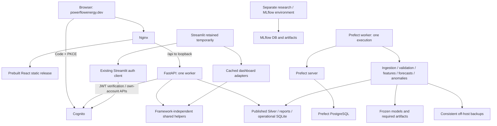

# Phase 5B.3 — Capacity validation and Streamlit dependency separation

25 October 2026, Africa/Nairobi. Branch `feature/react-frontend`; observed baseline `74afaff`. Local code/tests and architecture preparation only. No AWS calls, additional SSH commands, production workloads, service changes, account operations, deployment, dependency installation or Git staging/history changes occurred in this phase. Phase 5B.2 documentation changes already present in the checkout are retained.

**Decision: existing EC2 is conditionally suitable** for React + FastAPI as the sole production web application at **https://powerflowenergy.dev**. The measured idle snapshot supports continued single-host evaluation, not production-load acceptance. Peak pipeline/inference memory, installed API provenance/permissions, restore testing, encrypted storage and TLS renewal remain gates. A second permanently running host is not recommended within the credit budget.

## 1. Current service inventory and dependencies

Repository traces plus the previously authorized Phase 5B.2 host snapshot; no new remote inspection this phase:

| Component | Responsibility and evidence | Final disposition / memory behavior |
|---|---|---|
|Nginx|Observed active, about 7.46 MiB cgroup memory; public HTTP/HTTPS listeners. Installed routing/renewal configuration not inspected.|Retain TLS/static React and `/api/` loopback proxy. No production Node/Vite server. Small baseline, connection/buffer usage varies.|
|Streamlit|Observed active, about 198.37 MiB cgroup memory / 229.36 MiB process RSS, wildcard IPv4 8501; SG does not expose 8501 publicly.|Temporary UI and rollback only. Do not stop or delete now. Session/chart/DataFrame caches can vary.|
|FastAPI|Observed active service `powerflow-api`, ec2-user, about 8.16 MiB cgroup memory; uvicorn process and loopback 8000 observed.|Retain/replace with reviewed React API release and dedicated identity. Current low footprint is not a loaded-candidate measurement. Import/index/query peaks matter.|
|Prefect server|Active, about 209.95 MiB cgroup memory; loopback 4200.|Retain existing orchestration control plane; do not duplicate scheduler.|
|Prefect process worker|Active, about 321.36 MiB cgroup memory; template process worker limit 1.|Retain single writer/execution concurrency. Task process/import/DataFrame/inference peaks can exceed idle footprint.|
|PostgreSQL|Active as postgres, about 229.77 MiB cgroup memory, loopback 5432.|Existing Prefect metadata persistence, distinct from operational SQLite. Keep DB and recovery plan; do not repurpose or delete. Shared-page RSS cannot be summed naively.|
|Operational SQLite|Local file-backed runs, quality, incidents and timings, read via short query-only transactions.|Retain with one pipeline writer, consistent online backups and bounded API reads. No daemon per SQLite file.|
|Silver/report indexes|MarketStore and anomaly presentation indexes use in-memory SQLite, rebuilt when source version changes.|Not a second persistent database migration. One copy per worker; cold rebuilds temporarily retain old and new versions.|
|Frozen models/inference|Pipeline imports existing one-hour release and direct 24-hour HGB runtime; scheduled_pipeline calls load/forecast/report tasks.|Retain artifacts/features/withholding. API retrieves reports; it must not fit or load models on requests. Larger temporary arrays/imports remain unmeasured on EC2.|
|MLflow research/tracking|Repository training/evaluation scripts and mlflow.db/artifact directories; no distinctly named production server established by safe process-name snapshot.|Preserve required tracking/data. Do not infer need for an always-running MLflow UI or remove a generic process without tracing it. Research environment remains separate.|
|S3/config/backup access|Pipeline storage synchronization, secret delivery and recovery tooling.|Preserve required pipeline permissions; API service must not inherit production ingestion/root credentials. Existing instance-role deletion risk remains.|

The live port-8000 service cannot yet be proven to be **the same revision/configuration** as this React backend. Matching service name, uvicorn, loopback port and public health response establish a compatible-looking service, not a deployed source digest. The authorized bundle deliberately omitted argv, environments, unit contents and release identifiers. Do not overwrite/start another worker on the occupied port as a staging shortcut.



Existing public analytics routes remain intentionally backward-compatible; React route protection does not make every API route private. The seven Admin-only routes (five `/admin/*` routes plus two legacy monitoring aliases) keep server-side JWT/group dependencies. Own-account writes remain token-authorized Cognito operations, not general read-only market endpoints. No auth code changed.

## 2. Resource analysis and realistic scenarios

Phase 5B.2 host capture: 25 October around 20:25 Africa/Nairobi. Actual RAM 1,909.74 MiB, available 1,026.27 MiB (about 53.7%); swap approximately 4 GiB with 817.42 MiB occupied; nine fresh vmstat intervals show no swap-in/out, 97–99% idle and zero I/O wait. Root XFS has 11.93 GiB available / 41% used. Seven-day mean CPU around 3.19%, maximum observed sample 45.47%, no charged surplus CPU credits in that historical window. This is dated evidence, not a new remote measurement or peak bound.

MemAvailable includes reclaimable cache; free memory alone understates availability. Cgroup memory, process RSS, shared pages and swap are different measures; do not sum service counters as unique physical consumption. Occupied swap suggests prior pressure or inactive pages, not proof of current thrashing. Removing Streamlit later might release some memory, but its RSS is not a guaranteed saving.

With a proposed 25% physical-RAM reserve, only about **549 MiB incremental headroom** remains in that snapshot before reaching the reserve. Existing caches, cold pages and model tasks can consume it. The proposed 768 MiB API ceiling is therefore not an allocation shown to fit; it must be selected against measured total-host peaks. More ASGI workers duplicate imports/indexes and are not justified.

| Scenario | Evidence this phase | What remains / acceptance boundary |
|---|---|---|
|1. Idle application|Prior real-host snapshot above; all selected services active.|Longer observation and historical OOM/peak evidence not collected.|
|2. Dashboard requests|Local real-source market chart/exploration/context measured, values equal baseline; see section3.|No EC2 browser/network/TLS latency or user-session load certification.|
|3. Multiple API reads|Eight local chart/exploration calls on four threads completed in 1.066 s; shared MarketStore lock serializes index queries.|Function-call benchmark, not eight authenticated HTTP sessions or an external load test. Thread-pool wait/HTTP serialization require staging tests.|
|4. Forecast retrieval|Local 14,878-row historical report parsed in 23.66 ms median; 1,694,070 uncompressed JSON bytes. Context 1.39 ms; fixture-based next24 success/missing/invalid tests pass.|No live next24 report available locally; historical data is never relabelled current. Growing full-history response remains a resource risk.|
|5. Pipeline execution|Trace shows Prefect task stages, single-worker template and genuine model/report/source operations; full pipeline/model regression suite passes locally.|No production task triggered, no pipeline peak RAM/timing measurement this phase. Tests do not measure a real hourly run.|
|6. Pipeline plus traffic|Available RAM and swap imply a narrow conditional overlap budget.|**Unmeasured**; cannot approve same-host staging overlap or final capacity from the local benchmark. Observe scheduled peaks and test concurrent workload in isolation.|
|7. Model operations|Offline production import checker loads frozen models and tests output shape; full model tests pass. API cold-process tests block model-runtime imports.|No training/tuning/backtest capacity claim; keep research out of the web runtime. Real frozen-inference peak memory on EC2 remains unknown.|
|8. Restart/recovery|Offline ASGI lifespan, missing-data readiness and isolated database lock tests pass.|Cold index timing measured locally; Linux systemd restart/backoff, actual restored data, renewal and full rollback rehearsal remain pending. No production restart.|

Disk growth: current space is adequate for a measured snapshot, not indefinite retention. SQLite WAL, PostgreSQL WAL/backups, reports/history, S3 versions, MLflow artifacts, logs, multiple releases and encrypted-volume migration workspace need a retention/byte budget. Existing source/row limits are defensive caps, not memory sizing: a 512 MiB CSV/2M-row index can greatly exceed this instance's safe working set. Measure source sizes and cold replacement peaks before public release; no disk expansion/cleanup occurred.

## 3. Local performance validation and changes

### Measurements

Environment: macOS/Darwin arm64, Python 3.14.7, existing isolated API environment `/tmp/powerflow-api-5b1-clean`; no new packages. Local persisted Silver: **67,486 rows**. Three sequential runs per operation; warm-call medians, one cold index build. Baseline modules were exported read-only from observed HEAD to `/tmp`; no checkout/history change. Response dictionaries equal baseline, including coverage, sampled values/order, missing-hour flags and generation statistics. Source SHA-256 unchanged. No source outputs were generated or fabricated.

| Measurement | Baseline | Updated |
|---|---:|---:|
|Cold Silver index build|Not measured as a comparison|295.94 ms|
|Market chart, 1,579 points|141.74 ms / 1,580 SQL statements|139.43 ms / **2 statements**|
|Exploration, 988 weather points + eight generation means|134.30 ms / 997 SQL statements|125.80 ms / **2 statements**|
|Exact issue-hour context|Not measured as a comparison|1.39 ms|
|Historical one-hour parse, 14,878 records|Not measured as a comparison|23.66 ms|
|Eight local reads / four threads|Not measured as a comparison|1.066 s wall time, all completed|
|Whole-process high-water RSS|Not measured as a comparison|**171.27 MiB**|

Peak RSS includes interpreter, pandas, source index, retained responses, concurrent results and imported baseline modules. It is not incremental FastAPI RAM, container memory or a Linux/EC2 capacity projection. JSON byte measurement excludes transport compression/headers. Small timing differences are illustrative and susceptible to OS/cache noise; query-count reduction is deterministic, not a claim of a large latency improvement. Window sorting still dominates chart cost. No production URL is accepted by the benchmark CLI.

### Implemented optimizations

- `market_chart` retains the already computed source row rank with each selected point. For unique, ordered exact-hour observations, a timestamp distance exceeding rank distance proves a source-hour gap. This replaces one SQL count per adjacent point without hiding genuine gaps.
- `market_exploration` uses the same rank method for weather gaps. Count plus eight source AVG/COUNT pairs now share one aggregate scan; chart sampling is the second query. Same nullable values, source order, denominator rules and date filters remain.
- No response cache, TTL, freshness rewrite, model execution, schema change, API contract change or external service was added. Existing source-version refresh/lock behavior is preserved. Tests cover missing hours inside sampled spans, null values, bounded/all-history ranges and exact statement counts.

### Findings deliberately not disguised as resolved

- Legacy `/forecast/one-hour` still materializes every persisted row and serializes full history, despite displaying the last500 points in React. It is backward-compatible and unchanged here. Before unrestricted public production, approve a bounded/paginated contract and adapt full-history CSV export explicitly; do not silently truncate or serve stale cached data. Proxy limits/rate controls remain necessary meanwhile.
- Sync route functions run in FastAPI's thread pool; source scans/index rebuilds are blocking. A lock serializes MarketStore operations. More requests/workers do not automatically increase throughput and may amplify memory. Versioned index rebuilding holds old/new indexes temporarily and requires measured replacement headroom.
- SQLite operational reads already use query_only, mode=ro, short transactions, 250 ms busy timeout and close-on-exit; no migration/journal changes needed. Market presentation SQLite is in-memory and separately locked. PostgreSQL is used by Prefect, not the API's analytics reads.
- Evaluation parsing is bounded and version-cached, but time-relative metrics must continue being recomputed against current time. Model summaries hash versioned artifacts and never deserialize them; no model loading was introduced on API requests.
- Source summaries and chart windows still scan matching data. No Redis, extra DB, per-user unbounded cache or paid service is justified by this dataset. Local improvements do not establish rate-limit values for production.

## 4. Streamlit dependency inventory and extraction

Direct Python Streamlit imports found in `src/dashboard.py`, `src/dashboard_data.py`, `src/dashboard_health.py`, `src/legacy/dashboard_old.py`, and the lazy Streamlit import in `src/auth.py`. No direct Streamlit import exists in the ingestion/feature/model runtime merely because a helper previously lived in a dashboard module.

| Classification | Components | Treatment now / eventual retirement |
|---|---|---|
|Streamlit-only UI|dashboard.py, legacy/dashboard_old.py, theme/config, widget/session/chart renderers|Retained operationally; delete only after approved cutover/retention.|
|Shared market calculations|dashboard_data helpers used by forecast context and raw-price comparison|Extracted to `shared/market_context.py`; dashboard retains compatibility exports and cached I/O.|
|Shared health/business logic|dashboard_health freshness, quality, model-health rules|Extracted to `shared/operational_health.py`; same thresholds/reasons, no secret lookup or session state.|
|Shared evaluation calculations|next24h_monitoring pure realized summary, schema and pair thresholds|Extracted to `shared/forecast_evaluation.py`; original model module reexports for pipeline/Streamlit consumers. File generation/matching/inference remains in original module.|
|Data-access adapters|dashboard CSV cache decorators and SQLite history readers|Remain Streamlit adapters. API uses its own versioned index/short database snapshots, not these caches.|
|Authentication/authorization|src/auth.py Streamlit adapters/local legacy auth; src/api/security.py JWT/groups; React OIDC; Cognito account routes|Only Streamlit adapters eventually retire. No shared role/claim/password behavior changed or moved into UI.|
|Secrets/pipeline/ML|powerflow_secrets, ingestion, processing, scheduled_pipeline, model inference/artifacts, tracking|Preserve; API does not call alert secret-configuration probes.|
|Dependencies/deployment|requirements.txt/prod Streamlit pins, Dockerfile dashboard CMD, Compose dashboard, Streamlit unit, .streamlit settings|Retain until retirement; Compose other services share the image, and pipeline shares .venv-prod, so no blanket deletion.|
|Tests/tooling/docs|Streamlit AppTest/dashboard tests, import checks, benchmark_dashboard, CI and old runbooks|Keep adapter/parity tests now; future replace UI-only checks, preserving calculation/security assertions. CI now includes cold dependency-boundary tests in minimal API job.|

### Exact shared-code changes

Four new files under `src/shared/`: package initializer, market_context, operational_health and forecast_evaluation. **Fourteen function bodies are AST-identical to their baseline definitions**, ignoring source locations. Original modules reexport the same function names; pipeline public imports remain valid. Pair thresholds20/5, model-health100pairs/7dates, freshness/withholding rules, aggregation/renewable definitions and model lineage are unchanged. No fitted artifacts, source features, reports or forecasts changed.

API feature_parity and operations_summary now import shared modules directly, including realized schema constants. This removes both Streamlit and the accidental model-runtime dependency from data-backed evaluation requests. Cold subprocess regression blocks Streamlit, sklearn, joblib, MLflow, Prefect and boto3 imports and exercises genuine temporary-fixture market/chart/exploration/context/price/evaluation/operations responses. It also checks missing forecast404 and protected Admin401. Existing full-suite adapter and threshold/numerical tests verify the preserved Streamlit/pipeline behavior. Synthetic values are confined to tests, not application reports.

Streamlit is **not fully removed**, and must not be uninstalled yet. Dashboard adapters still legitimately require it. Extracting further helpers without a consumer is unnecessary scope; future retirement must trace all references before removing cache adapters or transitive packages.

## 5. React replacement / feature-parity review

Source and automated-contract review, not a new live browser/Cognito or production acceptance session. Existing historical live identity/MFA acceptance remains historical; it was not repeated or inferred from mocks here.

| Area | Existing React/API support | Retirement gate / intentional difference |
|---|---|---|
|Executive Overview `/`|Historical KPIs, source coverage, market chart/context, health/forecast availability|Validate installed publication equivalence and current timestamps at staging. Historical data must not imply live trading prices.|
|Market Intelligence `/analytics`|Price/load/generation/renewables, weather, source averages, date filters, bounded tables and displayed-page CSV|Exports intentionally label bounded/displayed/sampled scope rather than imply complete raw history. Confirm this scope is acceptable.|
|Forecast Intelligence `/forecasting`|Next24 chart/table/CSV and metadata, historical one-hour report/export, issue-hour context, realized evaluation, stale/withheld/missing states, Admin provenance|Real next24 and realized reports absent locally; genuine successful publication and stage CSV/withholding flows are cutover blockers, not missing route implementations. Full-history one-hour payload remains a capacity contract gap.|
|Anomaly Detection `/anomalies`|Persisted Isolation Forest output, date filtering, independent anomaly markers, summary, pagination/export|No detector/training runs in browser/API. Match active persisted output in staging; no invented anomaly score.|
|Model Insights `/models`|Separate HGB24h and linear1h summaries/evaluation provenance, coverage, Admin linear influence|Never attribute linear coefficients to HGB; report missing/corrupt artifacts honestly. Verify exact deployed artifact metadata.|
|Pipeline Operations `/pipeline`|Source health, quality history, timings, execution/incident tables and filters/export; protected monitoring|Latest100runs/100incidents/200timings are explicit bounded views. Raw operational text/secrets are intentionally excluded, not parity bugs to re-expose. Actual monitoring/incident data missing locally must be validated from legitimate publication.|
|My Profile `/profile`|Own-account information, supported name/preferred-label edits, native password management, federated guidance, reauthentication/sign-out|Unverified email changes, blanket MFA enrollment, removal and lost-device recovery remain unavailable/deferred. No fake settings. Account operations require separate live test approval.|
|Authentication / roles / MFA|Code+PKCE, protected UI routes, server JWT/group checks, seven Admin-route guards, account scope/type restrictions|Production callback/client/new-origin acceptance and hosted TOTP challenge need approved staging/cutover tests. General enrollment remains disabled; no live MFA change here.|
|Errors / loading / empty / downloads|Reusable API panels/retry, freshness classes, explicit unavailable data and formula-safe CSV|Frontend60tests pass. Seven route declarations retained; new desktop/tablet/mobile visual and production sign-in acceptance was not performed this phase.|

No feature was removed to simplify migration. Public observation summaries versus Admin detail, bounded exports and safe structured logs are intentional security/product differences, requiring owner acceptance rather than reproducing raw Streamlit internals. The remaining blockers are principally installed-environment/data/auth/resource verification, plus the growing historical-report contract; do not call this a production-complete parity certificate.

## 6. Recommended single-host configuration and staging decision

- Nginx serves an off-host-built immutable React release on canonical **powerflowenergy.dev**; `/auth/callback` SPA fallback, `/api/` loopback proxy, API errors never index.html. Keep existing domain/IP/TLS unless separately approved remediation requires change. No new permanent web host, ALB, NAT or public8000.
- One API worker, dedicated `powerflow-api` user/group, immutable release/isolated API lock, coherent read-only published data, no root/pipeline credentials. Installed ec2-user service is a known gap. Current8000 is occupied: approve release replacement or an alternate private validation port explicitly, never collide or expose it.
- Keep single Prefect execution, server/PostgreSQL and required shared pipeline state. Do not place research training/MLflow environment into API venv or delete shared .venv-prod. Preserve SQLite/MLflow artifacts and back up required databases independently.
- Proposed existing unit concurrency32/MemoryMax768M/CPUQuota100% are **unvalidated template settings**, not recommended proven-safe allocations. One cold worker/index plus pipeline peak must fit while retaining25% RAM/disk reserve. Start with a separately reviewed low concurrency for staging, measure queue/latency/peak memory, then choose exact limits. No deployed values changed.
- Retain graceful shutdown, Restart=on-failure/backoff, sandbox/readonly paths and bounded journald/proxy retention. Logs exclude credentials/query values/bodies; add minimal RAM/disk/backup-age/error alerts only after approval and pricing. No monitoring agent installed. Swap is a safety net, not a substitute for resident working memory.
- Existing host has plausible idle room for private read validation, but **same-host staging under pipeline-plus-traffic is not approved/proven**. Prefer isolated local Linux replay first. If overlap evidence fails or is unavailable, use a narrowly approved short-lived encrypted staging host; do not stop Streamlit to make an untested candidate fit.

## 7. Budget implications

No new billing API request this phase. Phase5B.2 verified estimated credits **$95.25**, both enabled credits expiring September2027 and eligible for relevant EC2/VPC/S3/monitoring/Cognito services. October1–24 estimated usage before credits **$16.80**. Refresh billing before provisioning; open-bill estimates change.

Preferred planning envelope remains **$31.43/month**, about **$62.87/two730-hour months**, including the known$20.434compute/20GiB/IPv4 baseline plus explicit S3, snapshots, monitoring, variable-usage and contingency allowances. These are allocations, not measured caps/free-tier guarantees. Root encryption migration may add retained-volume/snapshot storage. TLS certificate fee$0 with existing Let's Encrypt; renewal is not yet verified. No resource resizing or backup reduction is justified by a local benchmark.

Temporary separate t3.small staging,20GiB gp3 and IPv4: about **$1.34 for48hours** or **$9.41 for14days** if all billable temporary resources are then separately approved for cleanup, plus variable usage. With a$2staging variable allowance, two-month production plus14-day stage estimate **$74.27**, average **$37.14/month**—above preferred$30–35 but below$47.50maximum. Continuous dual hosts with planned extras exceed approximately$95; not selected. A single t3.medium with the same operational allowances is about$46.62/month, leaving insufficient contingency/staging headroom. Do not resize without measured need and additional budget review. Stopped instances still incur retained disk/IP charges. See Phase5B.2 for price sources, eligibility, retention assumptions and credit/cash limitations.

## 8. Cutover, recovery and final Streamlit retirement

Preparation only; Phase5B.2 sections10–13 remain the full runbook:

1. Demonstrate coherent off-host backups and isolated restore for operational SQLite, required Prefect PostgreSQL, reports/model metadata, MLflow state and protected configuration. Record actual RPO/RTO and hash/integrity evidence; current backup object listings are not recovery proof.
2. Resolve encrypted-root/backup deletion/API identity/installed provenance and renewal blockers through separately approved changes. Do not combine all infrastructure and application rollback risks in one untested window.
3. Validate clean Linux API/pipeline environments, read-only files, single writer, coherent publications and memory/performance under representative isolated workloads. Obtain approval for any live read-only/account tests and temporary resources.
4. Verify every required page, CSV scope, legitimate forecast/monitoring/quality data, artifact identities,401/403boundaries, native/Google/TOTP/expiry/sign-out without exposing credentials or enabling general enrollment.
5. Separately approve a production public SPA client: exact `https://powerflowenergy.dev/auth/callback` and logout `https://powerflowenergy.dev/`, code+PKCE, reviewed scopes/allowlists; preserve existing Streamlit client throughout rollback. No client/pool changes now.
6. Prepare reviewed immutable API/static release and exact Nginx diff on the existing domain, local readiness, prior release/assets and rollback operator. Verify certificate renewal and syntax before any approved reload. No DNS change inherently needed on same EC2/EIP.
7. Perform only an explicitly approved cutover, with minimal expected disruption after rehearsal; do not promise zero downtime. This phase does not authorize a service stop. Keep Streamlit rollback runtime/config intact; any transient-stop necessity needs its own approval.
8. Monitor real scheduled runs, memory/swap/disk/API errors and identity behavior for an agreed stabilization period (proposed at least7days). Abort on wrong roles, callback loops, unexpected writes, source mismatches, pipeline disruption, OOM/swap thrashing or TLS/readiness failure.
9. Rollback restores approved prior Nginx/API/static configuration and original Streamlit routing/session entry point, restarting Streamlit only if its prior stop was approved. Do not restore stale databases merely to roll back web code; pipeline writes continue under single-writer rules.
10. **Obtain separate approval to stop/disable Streamlit.** Only after successful React production validation and rollback retention obtain final code/dependency/unit/config/client/secret cleanup approval. Do not delete shared helper logic, .venv-prod, pipeline/ML state or shared Compose build paths. Re-run full suites, independent imports and restored-data tests after actual cleanup. Temporary staging resource deletion also requires approval.

## 9. Validation and reproduction

Commands executed locally; log files are temporary evidence, not secrets or committed outputs. Existing environment directories were reused; no installs. All tests are isolated/mocked where identity/cloud interactions occur. No real Cognito or production acceptance was repeated.

| Check | Final result |
|---|---|
|`venv/bin/python -m pytest -q`|**651 passed**,30.95s, including model and Streamlit AppTest regressions. `/tmp/pf5b3-backend-final.log`|
|Minimal API suite below|**207 passed,3 deselected**,5.64s; one existing AnyIO BlockingPortal deprecation warning. `/tmp/pf5b3-clean-api-final.log`|
|New independent import/gap cases|**5 passed**,0.74s standalone; included in final full/API counts. `/tmp/pf5b3-independence.log`|
|`venv/bin/python -m pip check`|No broken requirements; research environment|
|`/tmp/powerflow-api-5b1-clean/bin/python -m pip check`|No broken requirements; API environment|
|`/tmp/powerflow-orchestration-5b1-clean/bin/python -m pip check`|No broken requirements; separate orchestration environment|
|`PYTHONPATH=src /tmp/powerflow-api-5b1-clean/bin/python scripts/check_api_runtime.py`|Passed offline lifespan/import/readiness/invalid-data checks; blocked joblib added. `/tmp/pf5b3-api-runtime-final.log`|
|`PYTHONPATH=src /tmp/powerflow-orchestration-5b1-clean/bin/python scripts/check_production_imports.py`|Passed pipeline/Streamlit runtime imports and frozen-model shape checks. `/tmp/pf5b3-orchestration-imports.log`|
|`npm test` in frontend|**60 passed**,0failed; `/tmp/pf5b3-frontend-tests.log`|
|`npm run lint` / `npm run build` in frontend|Both passed; `/tmp/pf5b3-lint.log`, `/tmp/pf5b3-build.log`|
|Extraction AST comparison to baseline|All14function bodies identical; no calculations changed|
|Real-source baseline benchmark|Both sampled payloads equal; source hash unchanged; final output `/tmp/pf5b3-benchmark-final.json`|

Pip checks emit a local cache-permission warning and disable that cache; no sudo/cache permission change was attempted. An initial extraction edit misplaced a future import; it was corrected before final validation. An exploratory minimal-environment selection containing old Streamlit/model-dependent parity fixtures had10missing-dependency failures; those tests pass in the full suite. They were not deleted or globally skipped. The minimal job runs its applicable tests and explicitly deselects the three pre-existing model_runtime instrumentation tests. No dependency was added to disguise the boundary.

Run minimal API regressions from repository root:

```sh
/tmp/powerflow-api-5b1-clean/bin/python -m pytest -q -m 'not model_runtime' tests/test_api.py tests/test_api_security.py tests/test_account_management.py tests/test_mfa.py tests/test_backend_hardening.py tests/test_public_market_api.py tests/test_api_deployment.py tests/test_phase5_restoration.py tests/test_streamlit_decoupling.py
```

Reproduce the local read benchmark on existing persisted data, with no baseline dependency:

```sh
/tmp/powerflow-api-5b1-clean/bin/python scripts/benchmark_api_capacity.py --data-root . --runs 3
```

For the recorded before/after comparison, baseline files were exported using read-only `git show HEAD:src/api/market_data.py` and `git show HEAD:src/api/feature_parity.py` into `/tmp/pf5b3-baseline-market.py` and `/tmp/pf5b3-baseline-exploration.py`, respectively, then:

```sh
/tmp/powerflow-api-5b1-clean/bin/python scripts/benchmark_api_capacity.py --data-root . --runs 3 --baseline-market /tmp/pf5b3-baseline-market.py --baseline-exploration /tmp/pf5b3-baseline-exploration.py
```

Use a reviewed baseline matching this comparison; after user commits, HEAD may no longer be the original. Baseline options execute trusted local Python files, never remote URLs. The benchmark excludes HTTP/proxy/JWT/serialization latency except the separately reported historical JSON-size calculation. No production load result is claimed.

Production-mode validation is covered by `tests/test_backend_hardening.py` and `tests/test_api_deployment.py`: required issuer/client/data root/host configuration, reject wildcard/invalid origin, disabled deployed enrollment, hidden docs, sanitized errors, bounded SQLite locks, lifecycle and template checks. Offline fixture issuers/client IDs are not deployment settings. Actual unit activation, source version, Linux filesystem permissions and provider reachability remain unverified.

## 10. Outstanding blockers and approval boundaries

**Not production-ready yet:** measured Linux/EC2 pipeline-plus-request/cold-rebuild headroom; verified installed API revision/environment and dedicated service permissions; encrypted root; recent recoverable off-host backup with tested restoration; constrained backup deletion; installed proxy/renewal evidence; genuine next24/evaluation/monitoring publications for stage acceptance; bounded historical-report plan or explicitly reviewed exposure/rate envelope; production identity/client/domain tests and seven-route responsive acceptance. No new profile feature, recovery readiness or MFA rollout is implied.

If needed, propose the following **additional read-only inspection for separate approval**, not executed or included in the old bundle:

```sh
systemctl show powerflow-api.service --property=Id,WorkingDirectory,FragmentPath,User,Group,ActiveState,SubState,MemoryCurrent,MemoryPeak,MemorySwapCurrent,MemorySwapPeak,MemoryMax,TasksCurrent
systemctl show powerflow-prefect-worker.service powerflow-prefect-server.service powerflow-streamlit.service postgresql.service --property=Id,ActiveState,SubState,MemoryCurrent,MemoryPeak,MemorySwapCurrent,MemorySwapPeak,TasksCurrent
systemctl show certbot.timer --property=Id,LoadState,ActiveState,SubState,UnitFileState,NextElapseUSecRealtime,LastTriggerUSec
```

These inspect selected non-secret properties without argv, environments, logs, sudo or writes. Unknown properties/missing timer remain evidence gaps, not permission to install/change units. Historical MemoryPeak includes unit lifetime and is not synchronized pipeline evidence. An operator-sanitized deployed release/route/renewal summary and separately approved observational sampling across an already scheduled run are still needed; do not dump full units/Nginx configs or start jobs. Existing authorized bundle may only be reused within its explicit access boundary; no new host command ran here.

Next implementation/deployment requires resource-specific approval for any AWS/IAM/EBS/backup/monitoring change, host unit/permissions/runtime install, Nginx/TLS/DNS change, Cognito client/URL/scope change, live account test, production cutover or Streamlit stop/decommission. No infrastructure provisioning, staging deployment, streamlit uninstall or Git write is approved by this report.

## 11. Files changed in this phase

- `src/shared/__init__.py`, `market_context.py`, `operational_health.py`, `forecast_evaluation.py`: extracted framework-independent helpers/schema/constants.
- `src/dashboard_data.py`, `src/dashboard_health.py`, `src/models/next24h_monitoring.py`: compatible imports replacing moved definitions; existing caches, matching/report writes and callers retained.
- `src/api/feature_parity.py`, `src/api/market_data.py`, `src/api/operations_summary.py`: direct shared imports and equivalent SQL-scan/gap optimizations.
- `tests/test_streamlit_decoupling.py`: cold runtime independence plus four parameterized gap/query-boundary cases.
- `scripts/benchmark_api_capacity.py`: repeatable local, read-only timing/RSS/source-parity benchmark.
- `scripts/check_api_runtime.py`: explicitly forbid joblib along with UI/research imports.
- `.github/workflows/ci.yml`: extend minimal API job with deployment/restoration/independence tests; not a production deployment workflow.
- `frontend/docs/phase5b3-capacity-and-streamlit-decoupling.md`: this report; Phase5B.2 gains a current-status link. Previous Phase5A/5B.2 documentation work remains in the working tree.

No React application code, dependency pins, fitted models, generated market/report data, authentication implementation or production settings changed. Existing EC2 remains **conditionally suitable**, with a single-host replacement preferred once the explicit capacity/security/recovery gates pass.
